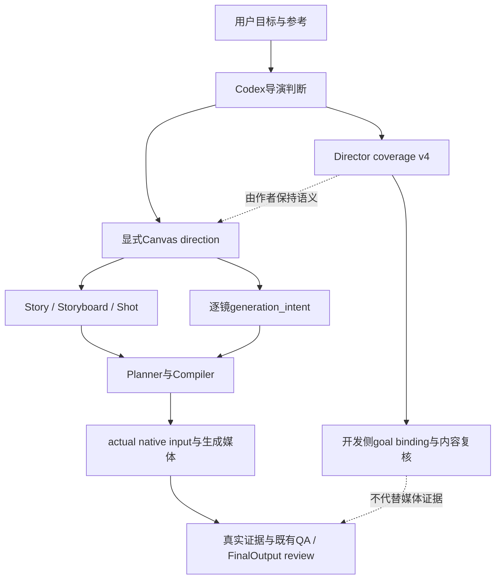

# Director Capability Study And Improvement Design

Date: 2026-10-21

## Assessment

AI-VIDEO 已有表达复杂导演意图的类型、制作入口、连续性保护和真实验收边界，也有不少正确的创作指引；当前证据仍不足以认定它具备稳定、成熟、跨题材的自主导演能力。最明确的缺口是：创意意图在作者交接时会被改写成较弱的可见行为；人物目标与阻碍尚未可靠转化为调度；对观众注意与反应时机的判断弱于对输入完整性的核对。增加字段、强制切镜、扩大动作或统一缩短 Prompt，都不能据此成为通用修复。

本研究的具体改进是假设：让 Director 在现有 authoring 中先比较不同的行动机制，再用空间草图、语义交接核对和不预先解释的概念复核排除坏方案。护腰贴提出了保持7秒连续开场的新方案，并实际完成两轮独立纸面复核；获得的是“行动因果更明确的设计假设”，不是实片质量改善、观众接受或商业效果的证据。

本轮只新增本报告。没有修改代码、Skill、Policy、Gate、历史合同、Product state；没有生成媒体、付费理解、Production submit、activation 或验收签署。其他窗口正在修改的文件和制作状态不属于本研究成果。

## Evidence And Method

以[Director Quality Audit](2026-10-21-director-quality-audit.md)为起点，重开其护腰贴原始brief、Director coverage、source、实际native文本、QA、diagnosis、白模和原片；核对《界蚀》原Shot及后续失败/修补记录，并把机器人、蚂蚁和青颜作为限制结论的历史案例。不是把多份记录或原片派生版本当作独立实验。

项目源码检查覆盖现有open-video、creative-completion、Canvas authoring/planning、Prompt Compiler、Performance、requirement semantics、FinalOutput review和Harness声明；CodeGraph仅提供关系定位，源码与具体输入决定结论。代码只读调查使用native `code_mapper`，外部方法调查使用native `conceptual_planning_agent`；无nested delegation。源码调查时HEAD为`af77125`；完成前共享仓库新增了`369630c`的重做记录，本轮继续追溯该新证据。其他窗口随后还在修改coverage，历史比较固定为`369630c`中的原coverage及下文SHA，不把正在变化的文件或其他窗口成果冒充本研究实现。

本轮显式调用project-local `video-analysis.video_analyze`，关闭转写和audio understanding。实际查看护腰贴原片0/1/3/5/7秒五帧、原白模0/1/3/5秒四帧；另看新重做原片0/0.5/1/3.5/5/6.5秒六帧、新白模0/1/3/5秒四帧、新双人参考图和两张商品参考图，共19张媒体样帧及3张参考图。它们补充前次audit的42张样帧，不是独立实验次数。没有重新取得完整原速听看，因此不判定自然表演、声音听感、无采样动态缺陷或完整观看体验。旧Gemini音义和用户反馈保持其原记录范围。

`retrieve-ai-video-memory` experience查询返回带stale标签的last-good片段，本轮直接重开重要来源，没有等待重建或把检索分数当证据。对外部项目冻结公开commit、实际读取文件，不安装Skill、不运行其脚本或调用其执行链。

### External Reading Inventory

| Source | Frozen revision | Actual reading and use |
| --- | --- | --- |
| Visual Skills，Serge Shima | `92be33a5a73325fb3d8e0c73b22744b114e2a90e` | [dramaturgy](https://github.com/smixs/visual-skills/blob/92be33a5a73325fb3d8e0c73b22744b114e2a90e/video/references/dramaturgy.md)全文；另读video/SKILL、role-modes、patterns-and-genres、animatic-keyframes、fixes-and-skeletons，及相关参考目录 |
| Cinematic Director，wangzhang-wu | `c65ae0d14457053efb1e354c7e7f7e120d97fad1` | [blocking-and-staging](https://github.com/wuwangzhang1216/DirectorSKILL/blob/c65ae0d14457053efb1e354c7e7f7e120d97fad1/references/blocking-and-staging.md)、[failure-modes](https://github.com/wuwangzhang1216/DirectorSKILL/blob/c65ae0d14457053efb1e354c7e7f7e120d97fad1/references/failure-modes.md)全文；另读cinematic-language、editing-and-assembly、sound-and-dialogue、production-workflow、product-and-macro、genre-playbooks、ai-video-tool-adapters、director_styles/example_comparisons与evals/run的相关部分 |

这两套材料都是作者方法与经验的primary source，不是电影原理的实验验证。Visual Skills为CC BY 4.0；此处归纳其方法并署名Serge Shima和来源，未vendor原文。[NOTICE](https://github.com/smixs/visual-skills/blob/92be33a5a73325fb3d8e0c73b22744b114e2a90e/NOTICE)还说明部分方法改写自agentara/skills。DirectorSKILL为MIT，Copyright 2026 wangzhang-wu；若后续复制实质文本须保留[许可](https://github.com/wuwangzhang1216/DirectorSKILL/blob/c65ae0d14457053efb1e354c7e7f7e120d97fad1/LICENSE)。本轮没有安装、复制实现或采纳其强制流程。

## Current Director Architecture

创意Director实际是执行Skill的Codex。当前open-video目录只有Skill、creative-completion reference和coverage validator；Skill中描述的上游core/planner、crafter、judge-loop不是已接入本项目的自动导演引擎。这不表示没有导演数据模型，更不表示应另建一个engine。

| Existing owner | What is actually implemented | What it does not establish |
| --- | --- | --- |
| [open-video](../../.agents/skills/open-video/SKILL.md)、[creative-completion](../../.agents/skills/open-video/references/creative-completion.md) | 区分新创作、忠实来源、失败修复；选择覆盖策略；要求观众体验、镜头职责、概念与成片复核 | Agent每次都能作出好选择，或实际执行了充分的审片 |
| [coverage validator](../../.agents/skills/open-video/scripts/validate_director_coverage.py)、[creative_goal_binding](../../scripts/creative_goal_binding.py) | 结构、枚举、时长、declared inventory、引用与ID绑定 | 动作有戏、隐喻易懂、约束提取完整、自然语言等义 |
| [canvas_authoring.author_canvas_project](../../src/ai_video/canvas_authoring.py)、[canvas_planning](../../src/ai_video/canvas_planning.py) | 显式direction生成Story/Storyboard/Shot；保留输入provenance；逐镜generation projection | 从coverage自动推导创意；两份正确数据表达同一个戏剧动作 |
| [VideoPlanner](../../src/ai_video/planning/video_planner.py) | 检查身份、continuity/motion、mode与generation requirement | 情节吸引力；其confidence不是审美置信度 |
| [H3 compiler](../../src/ai_video/production/_h3_prompt.py)、[remote compiler](../../src/ai_video/production/_remote_video_native_prompt.py)、[preserved source](../../src/ai_video/production/seedance_source_expression.py) | 将选定typed intent或保留原文表达为实际请求，并核对表达覆盖与identity | 自动补足被作者省略的叙事原因，或把乏味设计改好 |
| [performance_direction](../../src/ai_video/production/performance_direction.py)、[performance_authoring](../../src/ai_video/production/performance_authoring.py) | trigger、opening/response/settle、逐人表演；fresh authoring/cast/QA覆盖检查 | 动作幅度合适、反应有动机、演员自然；report明确保留actual quality未评估 |
| [requirement_semantics](../../src/ai_video/production/requirement_semantics.py)、[final_output_review](../../src/ai_video/production/final_output_review.py) | 要求QA owner给hard basis；核验完整合同与证据身份、strength和verdict | 自动判断艺术必要性，或独立看懂影片来替代evaluator/human |
| [Harness rules](../../.agent/harness/agent-rules.yaml) | 离线回归、结构/绑定/兼容性；明确director judgment不在coverage证明内 | 人看过、作品成立、生成质量或完整交付 |

重要交接风险：rich prompt主要从typed `generation_intent`构建；只写在`Shot.intent`里的创意并不当然进入native prompt。preserved-source路线则按封存原文表达；不能为了“增强导演”让compiler擅自改用户选定来源。首先应检查作者翻译，而不是假定Compiler偷删了剧情。

### Capability Gaps

| Capability | Evidence and judgment | Smallest useful improvement |
| --- | --- | --- |
| 把目标变成动作 | 护腰贴“想坐又停”在作者输入中变成站稳；见下文逐层对账 | 优先保留决定场景意义的行动，而非只保留情绪/场景名 |
| 人物动机与策略变化 | 原开场有无奈表情，但动作主要等对视；“关心”通过预置微笑表现 | 用角色试图对他人/物件做什么来指导，再选少量可见信号 |
| 空间承担戏剧 | 原白模和原片均见可坐空间；纸占座的阻碍未被清楚构成 | 在平面/起中尾图上检验目标、阻挡与动作路径；不能用文字宣布“被占满” |
| 注意力组织 | 长纸前景占据注意，真正的人物变化到后段；《界蚀》3秒承担复杂镜面对应 | 明确观众此刻需要看哪一项关系；有意悬念与无意看不清分开 |
| 节奏与反应时机 | 延迟到达的对视造成“慢”；剪成2.25秒又不含对视收尾 | 按信息/决定完成的时刻选择长度；长度变化后重审镜头功能 |
| 主次表演与层次 | 《界蚀》加八人subtle文字后，没有建立正常观看可读的改善证据；局部去手影没有改变脸部表演 | 主角的反应应因事件改变；背景是否不反应由剧情决定，不强制集体运动 |
| 方案与实现分责 | 旧输入确有重复/冲突；当前稿控制已修复，但无新实片效果证明 | 先做“完美执行现方案是否仍平”的反事实，再查表达、参考、生成和制作 |
| 跨题材与商业表达 | 青颜曾以正确包装单图替代完整创意而被用户拒绝；蚂蚁反有清楚动作推进但POV失败 | 按当前传播/叙事任务选方法，避免把易生成静帧、固定镜头或高强度动作当普遍美学 |

这不是“所有问题都是导演问题”。现有跨场景、跨镜头的类型与生成链是实质能力；没有一组代表性完整成片的反复视听验收，不能从代码功能、局部用户接受或本轮纸面比较推导成熟导演能力。

## External Methods Worth Transferring

### Dramatic Reasoning Before Parameters

Visual Skills的[dramaturgy](https://github.com/smixs/visual-skills/blob/92be33a5a73325fb3d8e0c73b22744b114e2a90e/video/references/dramaturgy.md)提供了有用的工作问题：人物现在要什么、什么阻挡、空间怎样体现关系、观众看哪里、节奏怎样让变化落地。这里可迁移的是推理顺序，不是其五元素的排他公式、每镜三细节或恰好五锚点的数量规定。

[role-modes](https://github.com/smixs/visual-skills/blob/92be33a5a73325fb3d8e0c73b22744b114e2a90e/video/references/role-modes.md)进一步把镜头职责与观众获知、动作推进、情绪变化、摄影/剪辑理由相连。用于本项目时，应说明删去/换掉一镜会失去什么；建立空间、等待、感官体验、重复或留白仍可有职责，不能机械删掉所有没有新动作的镜头。

该仓库自身的[patterns-and-genres §4](https://github.com/smixs/visual-skills/blob/92be33a5a73325fb3d8e0c73b22744b114e2a90e/video/references/patterns-and-genres.md)允许无对手的意义转变、单一峰值和开放结尾。它限制了dramaturgy前部的绝对冲突论。商业短片可从生活观察、关系、产品感官或一个笑点成立；不能硬造敌人、反转或高潮。

### Geometry And Motivated Performance

Cinematic Director的[blocking-and-staging](https://github.com/wuwangzhang1216/DirectorSKILL/blob/c65ae0d14457053efb1e354c7e7f7e120d97fad1/references/blocking-and-staging.md)最有价值的是把人物距离、遮挡、进退、让位和视线作为意思的载体；同一句坏消息，只改位置/高度/门槛即可产生不同关系。起始、中间可见变化、结果三幅图是有用的可画性检查。

对本项目的改进应是：先决定“她试图腾出休息位置”“他在看见她的选择后回应”，再决定视线、手势和身体变化。情绪词不必被禁止，它可以帮助作者/演员理解；但不能只剩眉眼/呼吸清单。已有本机Hell Grind的`references/performance-direction.md`本来就有触发、视线、重心与主次规则；缺口不全是知识缺失，也在选择、落实和复核质量。

[cinematic-language](https://github.com/wuwangzhang1216/DirectorSKILL/blob/c65ae0d14457053efb1e354c7e7f7e120d97fad1/references/cinematic-language.md)可用于把景别/视角/景深与信息关系联系起来，尤其区分观众看见原因还是先看见反应。其镜头数、焦段与距离建议只作设计起点；画面可读性要用实际构图核验，镜头数不能代替调度。

### Editing, Sound And Diagnosis

[editing-and-assembly](https://github.com/wuwangzhang1216/DirectorSKILL/blob/c65ae0d14457053efb1e354c7e7f7e120d97fad1/references/editing-and-assembly.md)对切镜理由、节奏变化、可用素材与生成长度的区分有帮助；但固定裁头尾、按ASL生成镜头数并不是本项目准则。剪辑须保留当前动作与叙事结果，时间仍由ResolvedTimeline执行。

[sound-and-dialogue](https://github.com/wuwangzhang1216/DirectorSKILL/blob/c65ae0d14457053efb1e354c7e7f7e120d97fad1/references/sound-and-dialogue.md)把声音作为注意与信息顺序的工具。护腰贴可以让纸声停止、落座衣料声和盒子轻触声形成节奏，而不是无条件加入BGM；《界蚀》广播是批准叙事，不因某种声音配方而移除。本轮没有听新音轨，不为任何具体混音签PASS。

[failure-modes](https://github.com/wuwangzhang1216/DirectorSKILL/blob/c65ae0d14457053efb1e354c7e7f7e120d97fad1/references/failure-modes.md)将“无聊”与生成没有执行区分，这是诊断的有用起点。其具体“根因”、成功率与不可约能力清单没有相称实验依据，不能从症状直接推成确定机制。两次类似失败也不能证明确定性，多个失败码不能证明必须拆成几镜。

## Conflicts And Limits

| External prescription | Decision for AI-VIDEO | Reason |
| --- | --- | --- |
| 每镜固定细节数/五锚点/冲击前必须暂停 | 不采纳为规则 | 数量可能驱动无关细节，抹平不同题材的节奏；来自Visual dramaturgy |
| 平淡戏按生死攸关表演、避免喜剧节奏 | 仅特定风格可选 | [fixes-and-skeletons的Weak drama](https://github.com/smixs/visual-skills/blob/92be33a5a73325fb3d8e0c73b22744b114e2a90e/video/references/fixes-and-skeletons.md)会与护腰贴的生活轻喜剧冲突 |
| 赛车animatic的冷色、无脸、固定层次/曝光偏好 | 只取静帧支持动作意图的方法 | [animatic-keyframes](https://github.com/smixs/visual-skills/blob/92be33a5a73325fb3d8e0c73b22744b114e2a90e/video/references/animatic-keyframes.md)的大量配方来自特定题材 |
| 一镜一个主体运动、固定角度/距离/接触时长上限 | 作为待检验风险提示 | 会把有价值的双人互动、动作与亲密关系削成单人静帧；尚非本项目模型能力事实 |
| 多个错误直接拆镜、换设计重置strike、同样失败即确定性 | 不接管项目recovery/counting | 症状可同源或不同源，历史消费/unknown不因设计变更重置 |
| 视频重打光保留表演、首尾帧解决端点、统一LUT解决风格 | 逐能力/逐结果验证 | v2v也可能改身份/动作；工具可用不证明效果不退步 |
| 后期藏手、反应替接触、移出倒影/人群 | 仅保留原目标时可选 | 《界蚀》的本人与空位同框、七倒影、左手求证不能被这种避险悄悄删掉 |
| 原生声音默认当scratch后期替换 | 不覆盖SourceAudioPolicy | 项目对KEEP/TRIM、原对白与付费授权有独立owner |
| 完整Director book/多表格/固定审批点 | 本轮不引入 | 本项目已有契约；缺口是判断质量，不是再填一套表 |

外部文本也有可核对的内部问题：DirectorSKILL的[adapter双人对话示例](https://github.com/wuwangzhang1216/DirectorSKILL/blob/c65ae0d14457053efb1e354c7e7f7e120d97fad1/references/ai-video-tool-adapters.md#worked-example--a-two-hander)要求single从轴线两侧拍摄，同仓[轴线owner](https://github.com/wuwangzhang1216/DirectorSKILL/blob/c65ae0d14457053efb1e354c7e7f7e120d97fad1/references/cinematic-language.md#the-axis-of-action-180-degree-rule)却要求同侧保持屏幕方向；后者可由平面几何验证。不能因该Skill专业词多而不核验具体建议。

其[八种导演风格对照](https://github.com/wuwangzhang1216/DirectorSKILL/blob/c65ae0d14457053efb1e354c7e7f7e120d97fad1/references/director_styles/example_comparisons.md)有时新增灯熄灭、包裹反复倒下，甚至将犹豫改成计算。这是有效创意探索，但不是严格保持同一事件的受控表达对照；不能直接迁移到忠实制作的《界蚀》。[evals/run](https://github.com/wuwangzhang1216/DirectorSKILL/blob/c65ae0d14457053efb1e354c7e7f7e120d97fad1/evals/run.md)也明确只评response-text行为契约，其发布比例不是成片质量证明。

## Hotpatch Comparison

### Original Goal And Historical Design

原[creative-input](../superpowers/artifacts/ecommerce/hotpatch-dayoff/creative-input.txt)要求直观、生活化、原创、目的明确的夸张、前三秒吸引、真人互动、产品质感与完整商业短片；没有固定24秒、纸卷、镜头数、缓慢推镜或subtle表演。当前研究授权充分重构方案，但没有授权实际生成。

[原coverage](../superpowers/artifacts/ecommerce/hotpatch-dayoff/director-coverage.json)为7秒建立纸卷占沙发、7秒伴侣收纸及商品细节、6秒共同休息、4秒包装。其优点是夸张不依赖虚构产品效果、家庭关系明确、保留真实包装；问题是首镜将主要时间交给观看纸卷和对视，阻碍与结果直到后段才处理。

### A Confirmed Semantic Handoff Loss

| Layer | Actual archived evidence | Interpretation |
| --- | --- | --- |
| coverage `S01.visible_change` | “纸卷继续滑入座位，女子想坐又停住” | 试图坐下与受阻应是可见行动 |
| source / actual native | “女子停在沙发左侧，身体轻微前倾后站稳”；右手自然垂下 | 站稳并不等于坐下受阻；关键动作在发送前已被弱化 |
| whitebox | 本轮所看0/1/3/5秒都是站立人物，纸占沙发一侧，其他可坐空间仍见 | 参考并未把原阻碍明确演出来；不是只缺真人表情 |
| raw QA action | 只具体要求纸卷滑动、女子看向男子 | 该判据的具体列举没有覆盖原“想坐又停” |
| diagnosis | action/performance等五项记为preserved，sound失败 | 历史裁决范围不等于原导演目标已保持，更不证明吸引力 |
| actual raw MP4 | 0–3秒仍主要看纸，约5–7秒转向并对视 | 与弱化后的输入相符；不能把所有缺失都归给模型 |

source、native、QA、diagnosis均位于`runs/hotpatch-dayoff-20261020-001/`，分别为`source.json`、`S01-native-actual.txt`、`qa-policy.json`、`S01-canonical-diagnosis.json`。实际执行原coverage validator仍返回`status=passed`、4units、24秒。这证明结构检查和上述语义缩减可以同时存在，不是validator对审美承诺失约。

对前次audit的收窄：应优先称为“作者交接和调度削弱了动作”，不能只笼统说分镜本来没有动作，也不能断言Compiler删掉了它。实际原片有女子手碰纸、手部职责与文本不同；这些属于进一步的执行偏差，不能据之签逐字服从。

2.25秒有声预览旧版SHA`51377c…`按源0–53frame的identity map截取，未包含原片后段对视。后续声音版已改为`9fc167e0d6adb0ff61c96ccec35c2d3b7cad1f7fa96e91575c9ef47b97bbcd17`；本轮只核对其记录，不把它称作重新听看的声音证据。两者都未证明原S01的全部功能已恢复；不将局部预览与新7秒设计混比来宣称速度获胜。

### New Counterevidence: Explicit Direction Still Failed

研究完成前，另一制作窗口记录了已知结果的6秒`S01R`重做，见[Directed Redo Checkpoint](2026-10-20-hotpatch-dayoff-edit-preview.md#directed-redo-checkpoint--2026-10-21)。这是另一窗口的实际生成，不是本研究调用、也不是下文“给自己让座”方案的验证。此处只读核对其`source-redo.json`、新参考图、白模、raw与diagnosis，不继承其剩余额度或待答授权。

这次source已经明确要求：女子试坐中央被纸占据的坐垫而停住；男子收走同一条连续纸带；同一坐垫露出后她才坐下。新白模也表现弯膝、伸手收纸、坐下的状态变化。这比原稿只写“前倾后站稳”具体，不能继续把失败都解释成没有写动作。

实际raw首帧却已坐在无纸的左座，0.5秒起身，约3.5秒纸带断开，5秒再次准备落座、6.5秒又坐回原左座。所看样帧支持原记录的关键失败：同一位置的受阻—腾空因果没有成立，纸的连续性也破坏。既有diagnosis对action/performance/space-camera给FAIL并关闭本镜；本轮未新增验收签署。

但这也不是“上游完美、纯模型失败”的受控证据。新双人参考图中女子身体位于空左座前，纸占中央/右侧；source还写“左侧空位不作为叙事焦点”。文字宣布忽略空位不能消除画面提供的可坐选择。白模是正面粗略几何，真实参考则有人体、坐垫与侧向机位关系，尚不能证明两者表达了同一个清楚目标。新参考对起始姿态/可用座位的暗示、纸带物理难度与模型执行偏差可能共同作用，现有证据无法量化贡献。

这条反证收窄改进承诺：补全动作文字有必要，但不足以证明导演能力改善；白模“有动作”也不足够。必须在实际取景中核对人物面向哪个座位、有什么替代位置、手/纸/坐垫如何对应。它也提高了下文纸卷方案的风险，而不是证明应该再试一次纸卷或必然放弃纸卷。

### New Design: 给自己让座

选择延续纸卷母题，是为了利用现有场景/角色/商品参考并直接验证原失败环节，不是把旧创意设为硬要求。另一个可行方向是不用纸卷、用下班后仍不断返回手机的动作建立休息邀请；它更写实，但会失去本次brief允许且期望的夸张视觉钩子。因此本轮优先研究纸卷方案，不把它定为唯一答案。

核心导演决定：人物不等伴侣代为清空所有任务，而是自己为休息腾出一个位置；工作仍未做完，关系从旁观转为一起停下来。纸的长度通过一个普通动作显出荒诞，表演不依赖更大表情。产品是此刻的照顾物，不能成为让工作消失或让身体即时改善的魔法原因。

保持与历史同样的7秒连续开场，便于分离“动作因果改变”与“增加切镜”的影响。以下时间是预演设计目标，不是给模型新增硬deadline，正常动作优先，不能为凑秒数变速：

| Time | Visible event | Attention / performance / sound |
| --- | --- | --- |
| 0–1s | 女子已经准备坐到休息位，座面纸带使她停住；手直接落向占座纸段 | 观众先看到身体目标与坐垫的冲突；没有疼痛表演 |
| 1–2.5s | 一次干脆的横向挪动，把座面纸段移到紧邻扶手、同高的边几；坐垫露出，长尾仍留地毯 | 手的去向对应可见空位；纸声结束，有明确结果，不表现整条任务完成 |
| 2.5–4s | 她正常坐下，包留身边，身体一次自然落定 | 目标达成，肩线变化有身体原因；不是用产品后的疗效反应 |
| 4–5.5s | 伴侣把指定橙盒放到她触手可及处，手撤回 | 回应她开始休息的选择；无抢物、无手递手 |
| 5.5–7s | 她先看盒，再短暂回应他；末态同时保留她坐下、任务未完、商品在身边 | 简短关系落点；衣料声、盒轻触声、room tone，不预设强制配乐 |

机位采用可见坐垫、手与两人反应的三分之四中广景，接近坐姿眼高；不让地毯上的纸长尾占据大部分前景。先验证固定机位能否讲清，再决定是否需要运动。观众注意应沿“待坐位置→清出空位→落座的人→关心她的人和商品”转移；不是先给摄影机一个温和推镜，再等待内容填满。

物理调度的具体修订：纸段落点改为扶手旁边几，手机后段落在同一平面纸段上，不落地；初始纸带预留松弛量，不把整个长卷拉走。目标是她日常就近准备落座的位置，身体路径与纸段在同一坐垫对应；不能保留触手可及的空座，再靠Prompt宣布她不能坐。三幅草图应分别显示：座面被该段纸占据；该段跨移到边几而坐垫露出；她已坐、纸尾仍在地上。它们是待排演的布置，尚无证据证明真实摩擦/遮挡/回落及7秒动作成立；新S01R失败使这个限制更具体。

完整24秒研究方案继续如下，保留整片目标，不把开场改善冒充完整广告：

| Time | Following passage | Why it belongs / remaining proof |
| --- | --- | --- |
| 7–12s | 由盒子的落点接到真实橙盒名称和贴片外观/表面细节 | 让观众知道关心物是什么；现有product-1是结构示意，product-3是包装营销图，不能冒充实物材质影片或核实45度/17年等claim；真实质感仍缺素材证明 |
| 12–16s | 手机振动，她惯性伸手，随后选择把手机扣在边几上的未完纸段上 | 从腾出身体空间推进到停止占用注意；明确她的自主选择，防止只读成整理沙发 |
| 16–20s | 伴侣看见这个选择，也放下自己的手机、坐到她身边 | 人际距离和行为改变完成共同休息；不是重复一段无因的相视一笑 |
| 20–24s | exact商品包装与“护腰贴”；片名“今天，腰先下班”，可选“待办，明天继续” | 完成商品记忆，不新增温度、疗程、认证、效果或未知使用方式 |

目前仍有实质创作风险：产品可能像生活故事中的插段；“选择休息”也可能只被读成收拾东西。7–12秒商品段要与盒子落点和后续人物决定连看，若只是突然切一张图，就应再改取舍。这里没有强迫所有品牌短片都必须具有唯一不可替代的产品故事，但不能用这种宽容掩盖商品关联不足。

### Actual Comparison Result

采用一个fresh-context native `reviewer_high`进行匿名纸面复核，未提供历史好坏标签；比较K、M、R，分别对应新初稿、历史coverage意图、实际弱化输入。为防止稻草人比较，主要基线是保留“想坐又停”的M，不是R。Reviewer只收到共同brief与等长分镜文字，未看新媒体；这是概念判断，非受众实验、盲看成片或完整质量审查。

第一轮指出：新初稿有“拉纸失败再改方法”和伴侣临时改变手势，转折过密；纸可能是杂物；商品可能外挂。Parent接受这些问题，删掉第一次失败拉纸与伴侣假起手，形成上述简化方案。第二轮确认动作链较明确、过载风险下降，但纸的物理关系、产品关联、自然节奏和吸引力仍未证明。最后在纸面上明确边几落点，仍保留实际预演缺口，没有要求第三轮机械争取通过。

| Dimension | Historical M / actual R | New simplified hypothesis | Present conclusion |
| --- | --- | --- | --- |
| 即时目标 | M有想坐，R主要站着看纸 | 起始身体已经趋向座位 | 设计上更直接；观众是否读到仍待预演 |
| 因果 | 开场内主要纸移动和对视，清纸在后段 | 清座→坐下在开场内完成 | 新方案有明确的动作因果优势，不等于更有趣 |
| 人物自主性 | 主要等待伴侣回应，后段由伴侣收纸 | 女子主动腾位置，后段主动放下手机 | 具体选择更清楚；“整理”误读仍可能 |
| 关系发展 | 微笑为主要反馈 | 关心物进入、两人依次停止处理手机 | 完整关系弧更具体，但未证明不平淡 |
| 镜头/动作数量 | 一镜、缓推、低幅表演 | 仍一镜；日常动作，固定机位待验 | 改进假设不依赖更多切镜或表情加倍 |
| 产品表达 | 延后进入，保真包装与使用不明边界保留 | 更早落盒，细节与共同休息衔接 | 尚有插入广告风险；早露盒不是自动胜出 |
| 真正观看效果 | 有旧媒体与慢动作感反馈；没有完整新验收 | 只有文字/空间方案与独立概念复核 | 不宣布新片获胜或可交付 |

## Constrained Case And Genre Transfer

《界蚀》以[批准S01](../superpowers/artifacts/drama/jieshi-episode-01/episode-01.md#s01--00000003--3s)为约束：3秒采用窗、本人及空位关系、七名他人倒影、左手靠窗、广播点名均保留。新方法只能帮助判断注意和制作分工；不能擅自把七人变两人、只拍倒影、用雨/蒸汽遮反射、加反应切镜或取消点名。

诊断需分开：空位关系在图上都读不清，是构图/信息设计问题；实际native没有正确表达批准动作，是交接/适配问题；输入和参考清楚而MP4生出手影/错人，是生成或合成问题；clean plate保护遮罩保住了残影，是局部制作问题。单个案例可能同时有几层原因，没有必要强行选唯一根因。

现有源文已经考虑几何一致的clean plate；[修补记录](2026-10-19-non-generative-video-cleanup.md)也证明局部去影不等于表演改善。[表演版记录](2026-10-13-jieshi-original-s01-s02-candidate.md#current-acting-s01--2026-10-20)保留“没看出区别”的反馈及脸部ROI不变证据；不能把新参数必填当作改善已发生。背景乘客不对异常反应本身服务批准故事，不应为“自然”强制全员转头。

| Kind | Useful directorial question | Avoided universal rule |
| --- | --- | --- |
| 商业生活短片 | 产品是什么、此刻为什么进入生活动作、关系/感官怎样让人记住 | 强制冲突、功效前后对比、所有片必须CTA或相同节奏 |
| 剧情漫剧 | 角色与观众分别知道什么，异常的对照为何可读，反应是否有知识依据 | 用旁白解释所有悬念、让全部路人抢戏、为易生成删批准事实 |
| 动作/追逐 | 目标、威胁、出口、路径与接触后果是否可读 | 以快切/大动作代替空间；把POV失败解释成风格自由 |
| 品牌感官/抒情 | 一个观看/聆听经验或意义转变是否完整 | 虚构敌人、每镜都要反转或压力升级 |

[蚂蚁旧片](2026-10-11-mecha-ant-seedance480-canvas.md)提供动作推进的反例，同时有明确POV失败；后续[原文版本](2026-10-11-mecha-fast20-original-input.md)的用户偏差接受只适用于该片。[机器人](2026-10-17-generic-h3-robot-reference-pilot.md)是时序测试，原声剪辑版有用户接受记录，不能因无戏剧性判导演失败。[青颜](2026-09-27-creative-goal-preservation-spec.md)则显示保真单图仍可能背离完整创作目标。它们共同限制“所有视频同一病因”的结论。

## Minimal Verifiable Improvement

本轮建议先改变Agent实际设计方法，沿既有open-video和creative-completion执行，不新增schema、validator、评分引擎、审批层或第二QA；本报告本身没有修改这些owner。未来若验证有效，再以本项目已有授权和学习owner决定是否采纳。

1. **先选表达机制。** 对尚未批准的新创作，比较两个含义上确有差异的方案，例如等待照顾与主动腾出休息位，而非同一方案换焦段形容词。允许冲突、无冲突、感官、静观、单镜或多镜；说明选择如何服务当前目标即可。
2. **做一次可画、可演的检查。** 用起始/决定性变化/结果三幅草图和必要平面位置验证看得见的关系；动作连不起来就修设计，不先填更多字段。三幅不是强制每镜三图，它是本案例的最小诊断工具。
3. **给演员任务，再给少量信号。** 写她试图完成什么、遇到什么反馈、怎样改变办法；既有trigger/body/gaze/phase字段足够承载。静止可以是有目的的等待，微动作不必多；不能用throughout的“微笑＋呼吸”替代本应发生的决定。
4. **核对关键意思穿过交接。** 人工重开coverage→Shot.intent→generation_intent/source→实际native preview，逐一指出核心动作/关系在哪里表达。护腰贴的坐下受阻是本轮明确漏点；检查的是意思，不是逐字相同或ID齐全。Compiler忠实保留了一个弱source时，应改作者输入而非让Compiler擅自增强。
5. **先让独立者描述看到什么。** 不先解释笑点/悬念、不先给成功理由。沿已有concept review收集复述、困惑与反证，再由Parent裁决；不新增多轮强制审查。媒体出现后仍按现有QA和完整成片视听核验，概念评价不能代替它。

### Next Small Test And Falsifiers

本轮已完成：历史coverage结构校验；source/native/QA语义对账；19张媒体样帧与3张参考图查看；并行窗口S01R重做的反证核对；两轮独立纸面复核；外部方法与当前代码边界核对。以下是尚未执行的最小实测设计，不是新调用或用户验收记录：

| Question | Smallest evidence | What would defeat the hypothesis |
| --- | --- | --- |
| 能否真的腾出座位、坐下并保留未完纸尾 | 用同尺寸座位、连续纸与替代盒做7秒正常速度调度预演；先不要求漂亮、不做新模型调用 | 纸回落/遮手/动作赶拍，或坐垫仍无法看清；需返回调度 |
| 是选择休息还是普通整理 | 给未读方案的人只看一次等长预演，复述目标、改变和留下的事 | 只读出整理，无法读到暂放工作；不能宣称休息隐喻成立 |
| 差异来自调度还是解释字幕 | 两案分别比较无字幕与同一句字幕“待办还没下班。”；不能只给新案加说明 | 只有文字让人懂，视觉行动差异不起作用；应收窄改进结论 |
| 商品进入是否自然、会否被误读为疗效 | 完整24秒预演连看，问为何有盒子、什么促使人物休息、片子说产品做了什么 | 被看作中途插广告，或推断出未支持的即时效果；重审商品段/剪辑 |
| 新方法是否可跨题材 | 用《界蚀》固定目标做注意/交接诊断，再用一个清楚动作案例做分责 | 为通过而改批准剧情、每次都得套相同结构、或把模型失误错判成导演失败 |

可先找2–3名未看方案的人做探索性观察，顺序交叉，只记录复述和具体误读，不以小样本宣称统计优势或发明全项目通过率门槛。本轮没有这些受众。实际调度/新素材若不可获得，停在纸面支持范围；不把新的生图、ComfyUI或有偿生成当作“免费研究”暗自开展。

真正通过的标准是行动和含义在实际画面里成立、完整目标和已满足项保留、无新增基础缺陷；自然度、趣味、观看意愿与商业效果要分别取得相称证据。若观感改善尚未发生，应保留该结论，而非用文档完整性补签。

## What Director Should Not Own

- 不替Prompt Compiler承担参数/参考槽/原文或typed intent的正确表达；可提供清楚意图并核对实际预览，但不能绕过适配能力。
- 不用导演话术解释凭据、egress、预算、permit、unknown outcome；它们由既有执行owner处理，本次也不把外部retry配方带入。
- 不用更激烈表演修多手、错字、镜面几何、遮罩接缝、编码偏色或音轨丢失；先由生成/制作/音频owner定位。
- 不从产品广告图、竞品示范或影片自然感核实使用说明、温度、材料机理或功效；当前已知事实与缺口保持。
- 不另建timeline、任意剪掉必须保留的动作或替换要求KEEP的声音；ResolvedTimeline与既有composition/QA职责不变。
- 不签human听看或推断CTR/CVR/retention；也不将用户一次接受扩成通用能力资格。

Director应对观众体验、目标的创作性转译、镜头和表演选择及整体取舍负责，也应识别这些选择能否被制作实现。把执行困难全推给下游，和为适应下游悄悄删除作品目标，都是不合格的分责。

## Evidence Anchors And Completion

| Artifact | SHA-256 |
| --- | --- |
| 原creative-input | `11d9297c7a2b61dd02c4f48ddf875edca84e2a335905050dbbe1ce2688aaa191` |
| 原Director coverage | `0404e504ed39d343b7627615a396428d74cc8d777c30dd2d674051edc0625ebc` |
| 实际native文本 | `2f88332c3c78634440a4e9d92327590d5f48221da38c1ecdaaa68deae3596e83` |
| 历史QA文件bytes | `f36ae19058d1a68bf0f7c6ff3a10ee12046753f3669327cac9bfa9431cc7079b` |
| 原白模MP4 | `b36b120d2b1d43d43468ef040890c682bfbfaa63cc31b168a6fbed3f8ac3b6b0` |
| 原真人S01 MP4 | `2df69a622b9cf0e869e028b5cf4882ce5539915f22e6bb9b1bfc95904516a10f` |
| 并行窗口S01R source-redo.json | `4d303ad914144b2c0b6071a8af1976fe0e0605e8c3f47ea6bca46e16fb8d95ca` |
| 并行窗口S01R双人参考图 | `6f75d09150ce708891476d9a4045b78078afabc09f402f0cc3195410b254332d` |
| 并行窗口S01R白模MP4 | `e9a73a8a0e87389171a40513d559465d3382b915ad94b66ec948f81094ee6e97` |
| 并行窗口S01R raw MP4 | `db324a0e4f2f89702739208b085891de27631a1077e69428c01b063c83feaf63` |
| dramaturgy.md frozen bytes | `12d9dcbea7d1050f35af919d0b704dd8db83f22c9070dbae34aeea96faf51bdc` |
| blocking-and-staging.md frozen bytes | `16203dd654d61459df6eabb7754d5b450a17774ad18484f27a1c05e73d392402` |
| failure-modes.md frozen bytes | `9a374e78ac8257ed8c91d7c247ebc2f1d27a3484b0c1486fee7d77e554fb9be7` |

独立纸面复核为native `reviewer_high`、task `blind_concept_compare`，两轮均真实返回具体CC findings；它未签新媒体或Production。Parent接受CC-01/02/03/05/06的适用风险，简化过载并明确边几落点；受众理解、物理预演与产品联系仍待实际验证。此为研究设计，无implementation，按Risk Gate不另加代码reviewer。

`record-ai-video-session`: 本报告作为唯一primary research record，不另造重复摘要。自动`distill-ai-video-learning`: `no_candidate`。既有异质媒体、Agent概念复核、参数表达测试与作者经验不能当作新导演方法的受控实片改善；本报告不创建待采纳Skill/Policy/Gate变更或`ADOPTED`声明。

文档exact snapshot验证receipt位置为`.agent/harness/runs/director-capability-study-20261021-r2/receipt.json`；实际验证与Git publication在本次交付中另报。它只证明本报告适用的工程检查，不替代上述未执行的验证。
