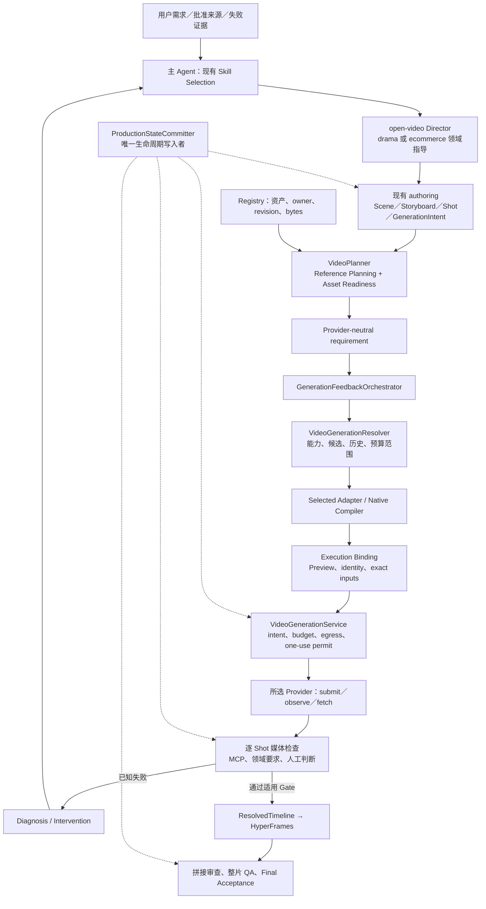
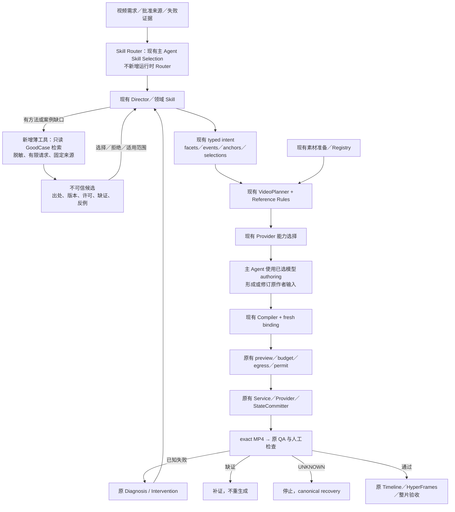

# GoodCase Skills Integration Architecture Review

Date: 2026-11-04

## Review Status Update — 2026-11-04

Claude 独立复核已完成，见 [GoodCase Skills Integration Independent Review](2026-11-04-goodcase-independent-review.md)。方向（方法融合、不装整包、不建第二执行链）获同意；P0 收缩为一份冻结的 `docs/research` 笔记且不改 Skill，P1 检索工具延后；§7 A/B 按现写法不可执行；§3 外部事实有更正项，另有遗漏的 runtime 事实（如 `multi_shot` 无条件 BLOCKED）。本文仍为 PROPOSED / NOT_ADOPTED，与复核冲突处以复核记录为准；下文“Claude 未参与评审”的说明已被取代，本文也不再是唯一主记录。

用户已授权将本文与复核记录一并提交并推送 `main`：下文 Review Status And Handoff 与 Verification And Learning Status 两段中“不提交、不 Push”的限制对这两份文件不再适用，其余限制不变。除本节外，本文内容保持原样。

## Review Status And Handoff

本文把同一会话完成的架构评审整理为可交给 Claude 独立复核的记录。正文结论为 **PROPOSED / NOT_IMPLEMENTED / NOT_ADOPTED**，不是实施授权、模型资格、媒体质量结论或发布依据。

- 用户范围：先分析，后明确授权“写成一个文档记录下”；本轮只新增本文件。
- 继续保留：不安装第三方 Skill/依赖、不执行未知脚本、不读秘密、不上传私有项目内容、不生成媒体、不提交、不 Push、不创建 PR。
- 本地审计基准：HEAD `d4f1f4d1e6654866737b710d4b8ffdc2c8cfbd31` 加当时 working tree；仓库存在大量并行 dirty edits。行号指调查时文件，不保证未来不漂移，也不代表内容全部属于该 commit。
- 外部固定版本：`LearnPrompt/goodcase-lite@34c716bfc6375ed335a52f78f63450258ed33fe7`；`LearnPrompt/awesome-seedance@67df3707a4f25f860088790fb0a74d8f99a50cbb`。
- 事实 **F**：源码、测试源码、原始文档或本次公开 GET 直接支持；推断 **I**：架构判断；假设 **H**：需要真实实验验证。
- 四个独立 Codex Subagent 均已完成：A 本地架构审计、B GoodCase 技术审计、C 接入设计、D 质量与实验设计。环境最多四个活跃 Agent（含主 Agent），实际最多三个 Subagent 并行；A 返回后启动 D。无可配置 Fast Mode，不声称已启用。
- 主 Agent 对参考规划、实际执行绑定、Registry、反馈、QA、模型资格及外部 API 反例做了复核；最终报告不是四份结果的直接拼接。
- 用户后来允许与 Claude 讨论。通过 discussion-with-claude helper、safe mode、禁用工具和会话持久化，仅发送公开资料摘要与抽象约束；Claude 返回 `429 usage_limit_reached`，没有取得意见，返回成本为 0。不能称 Claude 已参与评审。
- CodeGraph 查询未取得可用结果，关系以源码和测试源码为准。未运行视频生成、视频分析或工程测试套件；不把阅读测试称为测试通过。

## 1. Executive Summary

**值得有限接入，推荐 C（方法融合）为主、B（只读案例检索）为辅。** AI-VIDEO 已有参考素材决策、模型能力路由、生成控制及 QA/修复结构，无需重建。最值得引入的是可追溯案例检索、参考属性的继承/排除说明、带反例的制作方法与评测素材。最不建议原样安装整套生产 Skill、增加第二个 Router/Manifest，或把案例评分当验收。最大工程风险是把第三方建议升级为执行权威，同时掩盖已有覆盖和未证实的质量收益。

## 2. Current AI-VIDEO Architecture

### Current Flow

图中 Skill 属于 Agent 作者层；Production runtime 不调用 Skill。图示也不代表已有一个无监督完成全部语义判断的 Product Agent。Legacy CLI 与新 Production 路径不能混为一条能力证明。

### Existing Capability Matrix

以下均为 F；本地链接相对本记录所在目录，标签保留调查时行号。

| ID | 已有能力与真实边界 | 源码／合同证据 |
| --- | --- | --- |
| E1 | AGENTS 是规则源；CLAUDE 是薄适配。项目 Skill 正文在 `.agents/skills/`；检查型角色与主会话创作职责有区分。文件存在不证明本次调用。 | [CLAUDE.md:3](../../CLAUDE.md#L3)、[角色分工:15](../../CLAUDE.md#L15) |
| E2 | open-video 已拥有导演判断、coverage、动作、表演及参考准备；专项方法返回同一创作意图，不另行调度生产。 | [open-video:29](../../.agents/skills/open-video/SKILL.md#L29)、[专项与参考:44](../../.agents/skills/open-video/SKILL.md#L44) |
| E3 | Character、Scene、Storyboard、Shot 已有结构；Storyboard 关联场景和有序 Shots，版本/hash/provenance 由既有 artifact 契约承载。 | [models.py:261](../../src/ai_video/production/models.py#L261)、[Shot:376](../../src/ai_video/production/models.py#L376)、[VersionedArtifact:45](../../src/ai_video/production/artifact_contracts.py#L45) |
| E4 | 按语义选参考已经接通：VideoPlanner 调用参考规划，实际改变 mode，并可返回 BLOCKED，不只是报告。 | [video_planner.py:251](../../src/ai_video/planning/video_planner.py#L251)、[_reference_planning.py:61](../../src/ai_video/planning/_reference_planning.py#L61) |
| E5 | 已有 facets/events/anchors/selections/natural_generation；motion 根据接触、受力、支撑转换、高速、遮挡组合判断，不按固定图片数。 | [reference_planning_contracts.py:118](../../src/ai_video/production/reference_planning_contracts.py#L118)、[motion decision:15](../../src/ai_video/production/reference_planning.py#L15) |
| E6 | Registry reader 核验路径包含、文件存在、大小、SHA、registry revision；外部 URL 不是已注册资产。 | [registry.py:43](../../src/ai_video/production/registry.py#L43)、[load_asset_registry:198](../../src/ai_video/production/registry.py#L198) |
| E7 | prepare 经过候选、resolve_requirement、selected compiler、provider.resolve、execution binding；start 只持久化请求。 | [generation_feedback.py:344](../../src/ai_video/production/generation_feedback.py#L344)、[start:404](../../src/ai_video/production/generation_feedback.py#L404) |
| E8 | fresh binding 核验 Shot 身份义务、coverage、用户 preview，以及最终 image/media SHA 是否获认可。 | [generation_execution.py:454](../../src/ai_video/production/generation_execution.py#L454)、[reference_authoring.py:173](../../src/ai_video/production/reference_authoring.py#L173) |
| E9 | VideoGenerationService 围绕 committer 编排单次动作；副作用前重开、重编译并比较封存请求。成功、candidate、QA、激活是不同步骤。 | [video_generation.py:57](../../src/ai_video/production/video_generation.py#L57)、[submit:274](../../src/ai_video/production/video_generation.py#L274) |
| E10 | Intervention 已有失败项、保护项、证据、变化/保持变量和可证伪预测；诊断实验要求一个声明变量。 | [generation_diagnosis.py:255](../../src/ai_video/production/generation_diagnosis.py#L255) |
| E11 | Universal coordinator 只执行预选 Gate 1，不承担 Domain 或 Final Acceptance；逐 Shot MCP、人审和整片检查独立。 | [quality_gate_coordinator.py:358](../../src/ai_video/production/quality_gate_coordinator.py#L358)、[Per-Shot Gate:142](../../.agent/context/control-plane-playbook.md#L142) |
| E12 | Harness 已映射 reference planning、Planner、neutral requirement、feedback、reference packet 和 Architecture Gate；不判电影质量。 | [policy.yaml:527](../../.agent/harness/policy.yaml#L527) |

标准入口的调用链测试源码为 `author_canvas_project → bootstrap → load_production_project → canvas_feedback_context → prepare → Router/Compiler`；其中断言两个审看状态、零模型图片输入、质量 NOT_EVALUATED。[tests/test_reference_planning_integration.py:22](../../tests/test_reference_planning_integration.py#L22)。本次未运行该测试。

Prompt 版本与执行不是保存一段文本就完成：作者意图参与既有 hashes，编译后的请求进入 execution binding；提交前仍复核当前编译结果。所选 Provider 决定原生语法，第三方完整 prompt 不能绕过这条链。

### Actual Gaps

1. F：在审查的现有调用链未发现 GoodCase 检索或外部案例到 typed intent 的正式接线。
2. F：参考规划消费结构化事实，不负责从任意自由文本准确理解整个镜头。
3. F：Q0 RAG projection 仅返回 advisory Markdown，不自动写索引、查询或学习。[rag_projection.py:12](../../src/ai_video/quality_intelligence/rag_projection.py#L12)
4. H：GoodCase 是否超过现有强基线，尚无本项目对照证据。

## 3. GoodCase Capability Inventory

本节实际功能为 F，推荐位置和优先级为 I；所有视频质量改善均为 H。

| Skill / 能力 | 实际功能 | 本地是否已有 | 推荐接入位置 | 优先级 | 验证方式 |
| --- | --- | --- | --- | --- | --- |
| [goodcase][gc-skill] | REST 列表、详情、复测；不是生成器 | 有本地检索/经验体系，缺该外部来源 | Agent-facing 只读工具，由主 Agent 决定使用 | P1 | API 契约、出处、空结果、超限和注入测试 |
| [action-continuity-choreography][action-skill] | 人物、运动方向、动作阶段、机位和节奏 | 已有 Physical Action Continuity、typed events、motion 风险 | open-video 既有动作章节，只补不同的案例 | P0 审核 | 动作 A/B；等价内容不新增 |
| [animation-style-consistency][animation-skill] | 角色板、材质、线条、色彩和运动风格 | identity、style reference、参考排除职责已有 | 现有 identity/reference-continuity/model authoring | P1，按需 | 身份与画风分别评分，核对背景/姿态污染 |
| [storyboard-grid-to-video][grid-skill] | 格子顺序、动作状态、身份与构图分工 | Storyboard、预览、clean keyframe 已有 | storyboard 专项方法，不新增时间轴 | P2，条件性 | 实测顺序执行；grid 与逐帧方案分开测 |
| [horror-suspense-short][horror-skill] | 固定30秒、感染传递、反应、关门结尾 | 剧情、悬疑与表演指导已有 | 只提取适用局部方法 | 不原样接入 | 失帧不得继承感染、定长或结局 |
| [cinematic-drama-scene][drama-skill] | 关系、情绪转折、景别、停顿、环境声音 | drama-authoring、open-video、performance intent 已有 | 既有剧情/表演指导补例 | P0 审核 | 信息可读性、反应因果、自然度 |
| [seedance-production-workflow][production-skill] | 按需参考、继承/排除、entry/exit、接触点、逐镜修复；自带计划与运行记录 | 大部分已有 owner 覆盖 | 提方法，保留执行链 | P0 方法；整套不接 | 先检查是否有增量，再单变量实验 |

最后一个 Skill 位于 awesome-seedance 的 `agents/skills/`，不在 goodcase-lite 的 generated 目录。

### Source And Case Quality

五个 generated 视频 Skill 主体高度同构：读案例、选一个 anchor、写 Preserve/Replace/Avoid、输出 motion brief/prompt/checklist、修订一次。这是作者工作约定，没有接触检测、身份识别或媒体 QA 实现。其共同输入包括时长/比例/模型/平台、可用首尾帧/图像/视频/运动引导及动作声音要求；共同输出不是本项目可直接消费的 typed schema。

固定版本中，五个 cases.md 各含8张证据卡，头部分别声称来源于97、59、10、42、19个案例。卡片通常有作者、原帖、成片链接和 prompt 摘录，不等于完整输入/seed/模型版本/失败分母。

- [storyboard E1][grid-cases] 实际是单图一镜到底赛车，作者未明确模型；标签归类不证明 grid 方法有效。
- [action E5][action-cases] 区分继承身份/服装与不继承背景/姿态/画角，并描述接触点和反作用；这类具体约束比共同模板更值得研究。
- “官方 Skill”是 GoodCase 平台归纳；创作者包是非官方方法提炼，不代表模型厂商官方或作者亲自背书。[站点说明](https://goodcase.ai/skills)
- 本次未观看外部案例视频，视觉效果、物理连续性与复现率均未验证。
- seedance-production-workflow 自身也声明：案例支持提示结构，不证明端到端流程改善最终质量。[原文][production-skill]

### Public API Findings

| Probe | 本次实测 | 对接边界 |
| --- | --- | --- |
| GET /api/public/cases | 匿名可用；take=100 返回50条 | 不是已证全库语义检索或分页接口 |
| GET /api/public/cases/{slug} | 200；完整 prompt、来源、详细内容 | 初筛后再取详情，控制 Token |
| GET /api/public/cases/{slug}/retests | 200；逐模型记录 | 辅助审证，不代替本地 QA |
| form=ref-to-video + sample + seed | 线上可用；非法 category/form 为400 | 还须冻结实际 slug、获取时间和内容 hash |
| Header | X-Ratelimit-Limit=60、Scope=anonymous；Cache-Control=public | 源码为每IP每小时软限，不是 SLA；文档缓存不能当客户端保证 |

[Connect](https://goodcase.ai/connect) 描述线上能力；固定 lite 的 [list route][list-route] 仅处理 category/q/take/locale，未包含同样的 sample/form/retests。自行部署 lite 不等于获得线上完整服务。模型过滤是返回候选中的筛选，不是已证服务端模型语义索引。

主 Agent 独立复查 `real-case-01-umesh-ai`：详情推荐 Veo/Kling、stabilityScore=88、evidenceLevel=L2；唯一复测却为 MiniMax H3 768p，automaticOnly=true，verdict/rubricVersion/audio=null，finalScore=84。不能推出推荐模型复现成功；两个分数也不是同一量纲。[详情][case-detail]、[复测][case-retests]

静态 cases.md 适合冻结版本与离线审查；动态 API 适合发现新案例，但语料会变。同 seed 不保证未来语料不变；复现要保存实际返回集合和内容身份。

## 4. Architecture Delta

### Proposed Flow

模型 authoring 是 Agent 层活动，不是 Python Router 调 Skill。作者输入改变后仍须重走规划与绑定验证。图里的 Skill Router 由现有主 Agent Skill Selection 承担。

| 层 | 应承担 | 不应承担 |
| --- | --- | --- |
| Agent | 理解目标、识别缺口、选择组合方法、裁决冲突 | 案例标签直接选 Provider 或跳过人审 |
| Skill | 动作、空间、表演和参考职责方法 | 新生命周期、submit/retry |
| 工具 | 公开检索、字段校验、来源摘要 | 上传私有剧本、执行案例指令、自动导入媒体 |
| 数据 | 来源、版本、采纳/拒绝依据；素材沿原 Registry | 第二 Reference Registry 或 QA 真相源 |
| Harness | 契约、兼容性、注入防护、接线测试 | 用点赞/评分签质量 PASS |
| Runtime | 原 Planner/Router/Compiler/Service/committer | GoodCase 专用第二执行链 |

实质增量只有外部案例来源，以及现有作者决策的依据记录。

## 5. Recommended Integration And Reference Decisions

### Options

| 维度 | A 原样安装 | B 独立 Adapter/Router | C 方法融合 | 推荐 C + 薄检索 |
| --- | --- | --- | --- | --- |
| 维护性 | 上游变更会改变隐式行为 | 新 API/schema/调度维护最重 | 少量方法和出处 | 方法固定，检索可关闭 |
| 可解释性 | 指令叠加难追踪 | 可结构化但重复 authority | 延续原 owner | 记录案例到字段映射 |
| 自动化 | Agent 临场执行文字 | 高但重复已有能力 | 改善作者判断 | 自动检索，原链执行 |
| Token | 全量多包偏高 | 可控 | 按需章节较低 | metadata 初筛再少量详情 |
| 耦合 | 上游工作习惯进入本地 | 容易污染 Planner/Provider | 无外部 runtime 依赖 | 网络留工具边界 |
| 验证 | 多变量难归因 | 接线和创作混杂 | 易隔离方法 | 检索、方法、参考分别评测 |
| 扩展 | Seedance 假设外溢 | 第二能力表易分叉 | 语义可跨模型 | 消费原能力契约 |

最小方案：固定版本，提炼确有增量的方法到 open-video／模型 authoring 的适用章节，保留出处和限制，先做离线输入对照；不增加 Production 代码，不安装生产 Skill。与当前方法等价的内容只补案例或反例。

扩展方案：一个无生成权限的只读工具，由原 Skill Selection 调用。初始建议每任务最多两轮列表、三个详情及必要复测读取；这是待评估的工具预算，不是新 Product Gate。候选不足允许弃权，不扩成全库抓取。

候选排序：任务/动作结构适配 → 输入输出证据完整 → 模型/渠道/reference mode 可比 → 权利与素材可用 → 平台热度/评分。来源复刻、已批准镜头的窄修复或证据已足时不默认外查。

不推荐：全局安装全部包；导入上游 plan/run-manifest 状态；新增 GoodCase Director Agent；复制能力数据库；把全部创作统一成九宫格、固定秒数或固定角色板数量。

### Automatic Reference Decisions

语义判断仍在主 Agent + open-video；确定性需求、选择与能力校验留在 reference_planning.py、reference_strategy.py 与 Planner seam。GoodCase 只能提供依据。

| 条件 | 最小参考策略 | 升级条件 | 不应默认追加 |
| --- | --- | --- | --- |
| 可见角色需稳定 | 复用独立 canonical identity | 缺必要角度/服装细节 | 不因风格案例混入另一角色 |
| 单镜情绪 | 身份/环境锚点与 trigger→反应→稳定状态 | 某关键表情/姿态确难表达 | 不按情绪词一词一图 |
| 复杂空间 | 布局、入口、视线、遮挡关系 | 摄影与人物耦合，静态不足 | 简单空间不做动态白模 |
| 接触/承重/支撑转换 | 因果事件，按原 motion level 决策 | 持续接触+高速/遮挡等组合 | 普通触碰不强制视频 |
| motion 缺失 | 先审可复用动作视频 | 无合格素材且连续轨迹确必要 | 不见“复杂”就启动 Blender |
| 跨 Shot | 已接受前镜实际终态 | exact terminal／连续动作交接 | 换景、跳时、独立反打不一律传末帧 |
| 产品旋转 | approved product、结构材质 | 未见面需控制且有合格3D | 白模不替代真实材质 |
| 独立氛围 | 可考虑 T2V | 出现身份/空间/端点精度要求 | required duties 为空时可零模型参考 |

零新增图、零模型参考输入、零预览是不同概念。前两项不能取消剧情预览包与用户认可；身份豁免仍须封存。[参考包规则:150](../shot-reference-planning.md#L150)、[reference_authoring.py:173](../../src/ai_video/production/reference_authoring.py#L173)

当前 motion 等级 none/recommended/previs_priority/required 按组合风险计算；白模不是唯一 motion 来源。选中视频也不证明其动作适用或质量通过。[reference_planning.py:15](../../src/ai_video/production/reference_planning.py#L15)

一个 Shot 可以组合身份、动作、悬疑等不重复的方法，仍汇入一份 Shot/coverage/最终请求。冲突顺序：当前用户要求及批准事实 → Product/真实能力 → 现有 owner 创作决定 → 外部建议。记录拒绝原因，不能拼接矛盾指令。

动作分成挥击/接触/受力/撤退，不等于切成四个 Shot。时间码文字不证明精确控制；现有 Planner 对 exact_time 明确阻断。[规划限制:84](../../src/ai_video/planning/_reference_planning.py#L84)

### Proposed Data Contract

先增加工具返回／研究记录的 advisory 格式；下列字段全部为 proposed，尚未实现。

| 字段组 | 内容 |
| --- | --- |
| 来源 | case_id/source_url/source_author/upstream_commit/retrieved_at/content_sha256 |
| 证据 | evidence_kind/model_claim/observed_inputs/missing_evidence/counterevidence |
| 权利 | license_status/rights_scope，分开方法引用、下载、上传给模型 |
| 决策 | adopted_methods/rejected_methods/rationale/target_intent_paths |
| 参考转移 | reference_transfer/must_not_transfer |
| 边界 | authority=advisory，不包含执行许可或本地 QA verdict |

正式生成输入继续使用 ReferencePlanningIntent 与 ReferenceSelection{need_id,asset_id}；所选模型 Skill 返回 prompt_draft/reference_transfers/authoring_warnings。[现有 authoring 输出:154](../../.agents/skills/seedance-authoring/SKILL.md#L154)

案例作为方法依据时只是引用；真正的模型媒体输入须有可用权利、exact bytes，并经原导入、Registry/readiness 和 selection。不要新建 Reference Manifest。

必须保留的接线限制：authoring_input_reference 固定创建 user_input，require_authoring_input 也只接受它。SourceReference 虽允许 imported/derived，现有 helper/reader 并不因此支持直接导入 GoodCase JSON。[authoring_input.py:13](../../src/ai_video/production/authoring_input.py#L13)、[SourceReference:18](../../src/ai_video/production/artifact_contracts.py#L18)

P0/P1 先把来源与决策留在 advisory 研究记录，不混进用户原话、creative_input_evidence 或 preview_approval.user_quote。若将来确需 canonical 重放案例依据，再提受限 ExternalMethodEvidence 文档及 reader/证据 owner 接线，明确 imported source 与 derived decision；这是新增契约，不能冒称已实现，也不应顺手改历史 user_input helper。

### Targeted Repair

先核 exact MP4/QA 区间、reference bytes、实际 native roles/order、prompt，再区分参考不足、转移属性冲突、模型能力、文字遗漏、导演设计及剪辑时序。沿原 Intervention 记录失败项、保护项、变化变量、保持变量和预测；不默认加图或整片重生成。[reference_strategy.py:197](../../src/ai_video/production/reference_strategy.py#L197)

UNKNOWN 只走 canonical recovery；缺证先补证。文字/Logo 合成错误修 Composition，产品结构漂移修对应 Shot，末态改变复查接点。支持局部修复的真实范围仍由原 owner 与 selected capability 决定，不宣称任意模型都支持时间区间编辑。

## 6. Phased Implementation Plan

以下是后续计划，本轮未实施。

| 阶段 | 范围 | 验收 | 回滚 |
| --- | --- | --- | --- |
| P0 最小验证 | 固定版本，人工筛选；三个任务及边界任务卡的离线 A/B 作者方案 | 覆盖简单、身份、空间、接触、产品、跨镜；每项来源/适用理由/现有字段映射；无第二执行链；无增量判重复 | 丢弃建议，保留原方法；未证方法不升 Gate |
| P1 自动检索/选择 | 薄工具与原 Skill Selection 一处接线 | 无私有查询；来源版本齐；空/400/404/429/超时/坏JSON/注入明确处理；Provider calls=0；可选择不用案例 | 关闭检索，回本地方法；已冻结依据不依赖实时 API |
| P2 参考决策 | 优先改善 Director 填现有字段；实验证实规则缺口才改 owner | 零输入/身份/候选冲突/末帧/空间/motion/白模/unsupported控制可解释；同参考预算实测有增益；保留身份预览 | 撤回方法/规则版本；保留历史 hash/结果/消费，不迁移旧请求 |
| P3 QA/优化 | 复用 Diagnosis/Intervention/QualityExperience | repair绑定失败与保护项、compiled delta；UNKNOWN不retry、缺证先补证；保留失败；数据只作advisory | 停自动建议，回原诊断；不删失败、不自动改rubric/Policy |

后续工程验证按现有 focused → related → 发布前 full，使用 exact staged snapshot/commit range 和相应 receipt；低级别不能冒充完整回归。真实质量由逐镜/整片实测与人审证明。[Verification:100](../../.agent/context/control-plane-playbook.md#L100)

方法效果的不确定性应以最小有界实验回答，不先建完整智能路由工程；持续优化也不意味着自动改 Skill，学习候选仍需现有确认和 owner 验证。

## 7. A/B Evaluation Plan

### Shared Protocol

A 是当前完整体系：open-video + 领域 Skill + 参考规划 + selected model authoring + 原 Gate，不能用裸 prompt 制造弱基线。

| 比较 | 固定因素 | 主要变化 | 归因问题 |
| --- | --- | --- | --- |
| A vs B1 | 模型/channel/profile、时长、参考bytes、音频、合成、预算 | 一项 GoodCase 方法表达 | 方法是否超过强基线 |
| B1 vs B2 | 方法与其他输入 | 一项参考策略 | 参考收益是否值得成本 |
| 人工 vs 自动案例选择 | 同候选集与判据 | 检索/选择方式 | 自动选择质量，先离线测 |

没有可解释的有效输入差异时，标记已有覆盖，不为凑实验付费。修复 experiment 使用既有单变量要求；不要同时改模型、prompt、参考、时长。

每任务先3个配对单元的可行性 pilot，只判断信号；正式建议至少10个配对单元，按方差与事前停止规则判断证据是否足够，不把这个数字当统计功效保证。支持 seed 则固定，否则明确随机性，不声称像素可复现。

随机 A/B 提交顺序；两名独立标注者与第三人仲裁；原速带声盲评，逐帧用于诊断。保留 exact input/output hash、模型/profile/mode、native prompt、actual bindings、成本和全部失败/未知结果。

逐 Shot Gate 不过即停止该序列，不为凑数量继续后镜。未完成序列计入结果，避免幸存者偏差。单镜实验共用冻结前镜上下文；整段连续性另测。实验不得替换 active 成片或重做已认可镜头。

### Model And Admission Preconditions

- 短剧情/动作候选为同一即梦 seedance_2.0_vip、1080p，单次在所选 profile 范围内。
- 完整生成单元超过15秒时依原规则评估 seedance_2.5，不为实验机械拆戏；分辨率沿当前 selected surface 和制作规则固定。
- 广告使用同一批准渠道/model，生成与交付固定720p。
- MiniMax H3/Vidu 可作后续跨模型复验，不混入方法 A/B 主比较。
- 上述是候选，不是可直接执行的资格声明。当前 jimeng_models.py 的 production_qualification 为 UNQUALIFIED；须先满足既有资格/准入，资格试验不自动获得作品交付资格。[jimeng_models.py:17](../../src/ai_video/production/jimeng_models.py#L17)

### Test 1: Lost Frames Suspense Sequence

候选任务：便利店日常服务 → 人物缺席 → 林序求证的三个 coverage 单元。执行时冻结最新认可版本和实际状态，不能用旧剧本覆盖已制作镜头。[screenplay.md:3](../superpowers/artifacts/drama/shizhen-episode-01/screenplay.md#L3)

A 使用原方案；B1 只增强信息揭示、构图锚点或反应链之一；B2 另测一项缺失空间/状态参考。模型、角色/环境bytes、音频保持，时长按批准coverage与能力交集封存，不套感染/关门/30秒模板。

| 指标 | 权重 | 可重复依据 |
| --- | --- | --- |
| 日常建立、缺席、求证可见因果 | 30 | 事件存在与顺序 |
| 人物/服装/道具一致 | 20 | 预登记身份特征和approved state changes |
| 空间/轴线/视线/接点 | 20 | 空间关系与entry/exit |
| 叙事理解 | 15 | 未读剧本评审回答预定义问题 |
| 表演/节奏 | 15 | 锚定量表：无因果反应／成立但机械／自然可读 |

透明消失特效、不该留下的衣物、人物提前知情、关键对白截断为硬失败；有意缺席不能误判漂移。[剧本边界:57](../superpowers/artifacts/drama/shizhen-episode-01/screenplay.md#L57)。只修失败单元，出口改变重审接点与整段。

### Test 2: Continuous Contact Action

候选约8–12秒连续动作，执行前按真实动作与profile固定：挥击 → 接触 → 反馈 → 撤退。固定主体、目标、方向、接触点，不用切镜遮物理失败。

A 使用已有 Physical Action Continuity；B1 同素材测试一项接触/反作用表达；B2 同方法单独测试合格 motion guide，确缺才做白模。selected profile 不支持 required role 时 capability BLOCKED。

| 指标 | 权重 | 可重复依据 |
| --- | --- | --- |
| 四阶段完整、顺序 | 40 | 每阶段可定位起止帧 |
| 接触先于反馈 | 20 | t_contact与t_reaction，容许一帧标注误差 |
| 接触点/肢体/物体连续 | 20 | 穿透、瞬移、脱离的持续帧数 |
| 轴线、运动方向 | 10 | 与封存方向核对 |
| 力度、恢复、撤退可读 | 10 | 原速锚定评分 |

未接触却受力、明确穿透、瞬移、违背要求的慢动作/切镜为硬失败。2D关键点距离不能证明3D接触。先核prompt、bindings、guide质量，再分别只改文字/guide；两者均失败只形成模型能力假设，不单例定论。

### Test 3: Product Advertising

已批准商品三镜：外观 → 使用/卖点 → 收束，720p。可用每镜约6秒作为候选，最终由批准广告计划确定。A 使用原 ecommerce 工作流；B1 仅改展示角度/动作/衔接之一；B2 另测参考选择。固定商品事实、文案、profile、预算、音频和合成；Logo/文字由原Composition/HyperFrames负责。

| 指标 | 权重 | 可重复依据 |
| --- | --- | --- |
| 产品结构/数量/比例/材质 | 35 | 对照approved product reference |
| 卖点可见 | 20 | 画面是否证明批准展示目标 |
| 跨镜一致 | 20 | 产品、环境和动作变化可解释 |
| 文案准确可读 | 15 | OCR、显示时间、遮挡及批准文案 |
| 观众理解 | 10 | 预定义问题，不推断购买转化 |

产品变形、虚构功效、错误文案、不可核验遮挡、伪Logo为硬失败。文字层优先修Composition，产品漂移回对应Shot；不默认重做整条广告。

### Thresholds, Cost And Stop Conditions

- 单片合格：全部必查项PASS，评分不抵消硬失败，用户验收独立。
- 建议方法门槛：B平均高至少8/100，配对差值95%置信区间下界大于0；证据不足保持未证实，不降低门槛。
- 原已满足要求不得回退；报告非目标维度的变化分布。
- 同报首次通过率、硬失败率、合格单元成本、修复次数、作者/评审耗时，禁止只挑最佳样本。
- 三项首轮pilot最多42次视频submit（三镜任务各18，单镜6）；可先一对验证可执行性，再扩至三对，Gate失败使实际次数更少。B2、正式试验另设有限单元，不能自动续费。
- 金额按当次封存的operator ceiling与真实结算记录，不用GoodCase costBand估算授权；本报告不执行这项预算。
- 本轮视频submit=0，三个实验媒体效果均NOT_EVALUATED。真实批量制作前仍有项目代表性Pilot与人工GO/NO-GO要求，不能由本实验设计代替。

## 8. Risks And Open Questions

| 风险 | 边界与应对 |
| --- | --- |
| 第三方指令越权 | 内容当数据；不执行命令、不改预算、不自签QA；其全文输出/导流要求不接管本地输出 |
| 版权混淆 | awesome代码/Skill为MIT，编选/统计/摘要等CC BY 4.0，底层prompt/媒体权利归作者；仓库许可不自动授权商业模型输入。[声明][license] |
| 上游漂移 | 固定SHA、审diff；禁止moving main自动升级改变触发/方法 |
| 案例偏差 | 成功展示缺失败分母，不由数量/点赞估成功率 |
| provenance过度解释 | verifiedAgainstSource与发布policy/sourceUrl相关，不是逐条独立receipt。[源码][provenance] |
| 模型/渠道差异 | Skill说法、模型宣传、渠道约束、本地资格分开；selected profile/adapter决定可执行性 |
| 过度参考 | 增图会污染身份/姿态/背景；motion可能带错动作，须审exact source |
| 文本覆盖误当质量 | compiler可核文字保留，不能证明语义正确或模型服从。[reference_strategy.py:172](../../src/ai_video/production/reference_strategy.py#L172) |
| 第二控制平面 | 上游manifest/状态/validator不接；validator只查结构、引用和时长，不查视频语义。[validator][validator] |
| 自动修复被夸大 | 现有feedback不是任意prose自动改写器；修复仍经typed delta、原执行准入和人审 |
| 网络与隐私 | 只发送公开类别词；私有剧本/人物/商品资料不外传，媒体URL不自动下载转发 |

尚待回答：哪些方法超过本地强基线；自动案例选择是否稳定；参考成本是否值得；不同Seedance渠道、MiniMax和Vidu能否迁移。外部复测、安装成功和结构验证均无法回答这些质量问题。

## 9. Final Recommendation

直接复用现有 open-video、drama-authoring、ecommerce-ad-workflow、按需ad-creative、scenario-identity-library、scenario-seedance-storyboard，以及所选模型的seedance-authoring/h3-video/vidu-authoring。

外部包暂无值得原样安装并取得执行权的对象。goodcase检索协议可复用，经受限工具接线；不整体加载其原指令。

应按需提取：可追溯选择与拒绝理由、inherit/do-not-inherit具体表达、人物侧/相机侧/接触点/方向、逐时段失败及窄修复案例。等价方法只补证据，不复制规则。

不接入：固定30秒/格数/三个Preserve traits；所有镜头强制角色板/白模/末帧；外部生产状态；平台评分驱动自动选模型或QA放行。

后续可能修改的范围：open-video已有参考章节、所选模型authoring局部指导、一个Agent-facing只读检索入口及测试。只有实验证实规则缺口才改reference_planning/reference_strategy。canonical外部证据契约独立作为可选后续需求。

保持稳定：Manifest、Registry identity、ProductionStateCommitter、Provider transport、预算/permit、UNKNOWN recovery、ResolvedTimeline、HyperFrames及验收authority。

目标架构：原导演理解与决定，GoodCase提供有出处的候选依据，原参考规划/适配约束执行，原QA与人审判断实际结果。

## Claude Review Brief

请先独立核对当前源码与固定外部版本，再挑战本报告；当前仍只允许分析，不实施、不安装、不生成媒体、不提交。重点回答：

1. 有没有把“有代码/测试源码”误当“已通过当前测试或真实媒体验收”？
2. 是否遗漏已经存在的接线，或把未来advisory契约误称已可直接写入？特别复核user_input/imported边界。
3. C为主+B薄检索是否仍有过度工程？P0可否只补案例而不改Skill？
4. 零新增图、零模型参考、预览包是否分清？是否不小心削弱身份和用户认可？
5. 方法A/B是否实际有增量；参考数量、时长、模型随机性、评审偏差和失败序列是否造成混杂？
6. 模型UNQUALIFIED、精确时间码、motion输入、网格分镜的能力边界是否描述准确？
7. 原始媒体许可、案例评分、官方/创作者标签是否被过度解释？

建议返回“同意／反对／待补证”清单，每项附证据与最小建议；不要只复述结论，也不要把本报告视为实施计划已经获批。

## Verification And Learning Status

架构调查证据：本地源码/测试源码阅读、公开Skill/案例/API源码、匿名GET与主Agent交叉复核。未运行完整测试或Harness，未观看GoodCase媒体，未执行视频实验。历史记忆只用于导航，本文事实引用当前代码与公开来源。

文档落盘验证：单独运行 `.venv/bin/python -B -m scripts.docs_contract_gate check --json` 返回 `ok=true`、无诊断；本文件38处本地链接的路径与行号范围、15个引用式链接定义、九节结构和两处Mermaid围栏检查通过。围栏检查不代表执行过Mermaid渲染。另检查新增文件的diff空白格式。以上为文档检查，不是exact staged snapshot上的正式Harness run，没有Harness receipt，也不证明业务回归或媒体质量。

记录授权取代此前本会话的no_record选择，仅允许保存这份文档；没有扩大业务实施或外部效果范围。不提交、不Push的限制继续有效。此文为本次唯一主记录，没有需要同步改写的既有GoodCase记录。

学习评估：no_candidate。独立Subagent报告、API重复读取和代码事实不是独立媒体实验；没有受控视频多臂结果，不能生成已支持/已采纳的质量Learning Claim，不改Skill/Policy/Gate，不刷新RAG。

## External Source Index

[gc-skill]: https://github.com/LearnPrompt/goodcase-lite/blob/34c716bfc6375ed335a52f78f63450258ed33fe7/skills/goodcase/SKILL.md
[action-skill]: https://github.com/LearnPrompt/goodcase-lite/blob/34c716bfc6375ed335a52f78f63450258ed33fe7/skills/generated/action-continuity-choreography/SKILL.md
[animation-skill]: https://github.com/LearnPrompt/goodcase-lite/blob/34c716bfc6375ed335a52f78f63450258ed33fe7/skills/generated/animation-style-consistency/SKILL.md
[grid-skill]: https://github.com/LearnPrompt/goodcase-lite/blob/34c716bfc6375ed335a52f78f63450258ed33fe7/skills/generated/storyboard-grid-to-video/SKILL.md
[horror-skill]: https://github.com/LearnPrompt/goodcase-lite/blob/34c716bfc6375ed335a52f78f63450258ed33fe7/skills/generated/horror-suspense-short/SKILL.md
[drama-skill]: https://github.com/LearnPrompt/goodcase-lite/blob/34c716bfc6375ed335a52f78f63450258ed33fe7/skills/generated/cinematic-drama-scene/SKILL.md
[production-skill]: https://github.com/LearnPrompt/awesome-seedance/blob/67df3707a4f25f860088790fb0a74d8f99a50cbb/agents/skills/seedance-production-workflow/SKILL.md
[grid-cases]: https://github.com/LearnPrompt/goodcase-lite/blob/34c716bfc6375ed335a52f78f63450258ed33fe7/skills/generated/storyboard-grid-to-video/references/cases.md#L9-L25
[action-cases]: https://github.com/LearnPrompt/goodcase-lite/blob/34c716bfc6375ed335a52f78f63450258ed33fe7/skills/generated/action-continuity-choreography/references/cases.md#L64-L75
[list-route]: https://github.com/LearnPrompt/goodcase-lite/blob/34c716bfc6375ed335a52f78f63450258ed33fe7/src/app/api/public/cases/route.ts#L63-L90
[case-detail]: https://goodcase.ai/api/public/cases/real-case-01-umesh-ai
[case-retests]: https://goodcase.ai/api/public/cases/real-case-01-umesh-ai/retests
[license]: https://github.com/LearnPrompt/awesome-seedance/blob/67df3707a4f25f860088790fb0a74d8f99a50cbb/README.md#L342-L360
[provenance]: https://github.com/LearnPrompt/goodcase-lite/blob/34c716bfc6375ed335a52f78f63450258ed33fe7/src/lib/provenance.ts#L68-L89
[validator]: https://github.com/LearnPrompt/awesome-seedance/blob/67df3707a4f25f860088790fb0a74d8f99a50cbb/agents/skills/seedance-production-workflow/scripts/validate_plan.py
