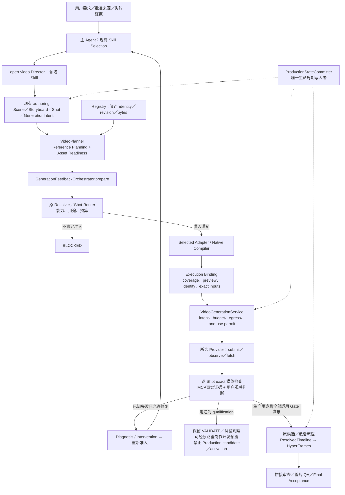
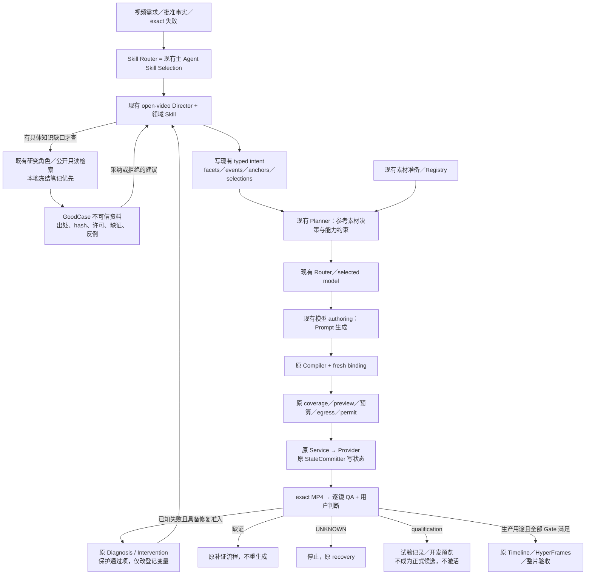

# GoodCase Skills Integration Architecture Review

Date: 2026-11-04
Revision: 4 — conditional local Skill reference connected

## Review Status And History

**P0资料和open-video的按需本地案例入口已落地；案例方法仍未被采纳为通用规则，runtime接入未实施。** 用户先要求“实现”，随后明确同意增加轻量Skill入口，见下方两个完成项。本文不授予后续网络接线、媒体生成、模型资格、激活或发布权限；没有GoodCase增强后的本项目媒体质量证据。

本文是当前综合评审；[Claude 独立复核](2026-11-04-goodcase-independent-review.md)保留原始反对意见与调查记录。本版修正正文，而非仅在开头声明“冲突时看另一份文档”。原版中的批量付费实验、立即开发检索工具、宫格多切镜试验和笼统资格表述已撤回；历史原文保存在 Git `c324272d`。复核意见也不是代码事实，以下按当前源码进一步限定。

- 初次调查基线为 `d4f1f4d1e6654866737b710d4b8ffdc2c8cfbd31` 加当时 working tree。本次修订基线为 `c324272d` 加当前工作树；行号指核对时源码，不把并行修改算成本任务成果。
- 初次实际完成四个 Codex Subagent：本地审计、外部审计、接入设计、质量评测。环境含主 Agent 最多四个活跃 Agent，实际最多三个子代理同时运行，之后启动第四个；无可配置 Fast Mode。此次修订由主 Agent 对用户提供的复核逐项核对。
- 初次 Claude helper 调用返回 `429 usage_limit_reached`，没有取得意见；之后用户提供的独立 Claude 复核已完成，并与原报告由另一会话提交为 `c324272d`。不再声称“Claude 未参与评审”。该会话记录的提交授权不作为本次修订的提交授权。
- Revision 2仅修订本评审；Revision 3另新增下方链接的冻结研究笔记。两轮均不改业务代码、配置、Skill或他人dirty文件，不安装、不执行第三方脚本、不读取秘密、不上传私有资料、不生成媒体。本轮仍不提交、不Push。
- 外部固定版本：`goodcase-lite@34c716bfc6375ed335a52f78f63450258ed33fe7`；`awesome-seedance@67df3707a4f25f860088790fb0a74d8f99a50cbb`。在线资料与临时抓取均注明调查范围，不把它们当固定服务契约。
- 证据标记：**F**＝本轮或原审计直接核对的源码/原文事实；**R**＝其他会话报告或历史记录，未在本轮重演；**I**＝合理推断；**H**＝待媒体验证的假设。读过 tests 不等于运行通过；运行通过不等于用户接受。
- 检索边界：本路径仍归入`advisory_experience`，frontmatter的research_note/ineligible不改变其authority；新笔记位于research语料，归advisory_research。Revision 2未刷新索引，Revision 3既有CLI的自动增量维护见P0完成项；旧片段可能过期，应回读文件。部分结论仍有效，因此不用仅适于完全替代记录的retrieval: retired。[分类实现](../../src/ai_video/agent_memory/corpus.py#L226)

## 1. Executive Summary

**值得作为有出处的研究素材保留，目前不值得新增运行时接入。** 推荐“方法对照与案例补充”；P0冻结笔记与open-video按需本地入口已落地；自动检索留到真实任务证明瓶颈后。三个候选增量是可追溯案例、身份/背景/姿态的具体取舍措辞、接触与反冲的局部表达；其方法骨架本地已有，质量收益未证实。最不建议原样加载第三方生产指令、再造Router或专门大规模付费跑分。最大风险是把案例、研究笔记或自动评分误当执行授权与经验事实，尤其经user_input入口混淆来源。

## P0 Implementation Checkpoint

用户在Revision 2交付后要求“实现”。已新增 [GoodCase Frozen Case Notes And Research Procedure](../research/2026-11-04-goodcase-frozen-case-notes.md)，完成P0资料整理，并把P1的人工检索规程做成可直接查阅的文档；没有自动检索工具，也没有修改Skill或运行时。

- 4张案例卡记录slug、作者、原帖、固定SHA文件、UTC、原始字节hash及hash_basis；四份源文本经固定URL回读，主Agent核对缓存hash一致。两张候选与两张反例均标未看媒体、未验证本项目效果。
- 笔记映射到既有Director、ReferencePlanningIntent和模型authoring；明确简单任务不必加参考、缺商品实证不强填案例，以及宫格/多切镜和user_input边界。
- 记录检索网址模板、固定词表、最多8次GET工作上限、弃权条件、出处/许可和选拒理由；未运行新GoodCase API查询，没有把外部原prompt复制入库。
- 既有`all`检索在本轮正常返回；experience分片超过64块前台刷新预算，CLI自行排队刷新并返回stale标记。本轮未手工build或等待刷新。新笔记是否能在实时排序中命中未验证，验收仅检查既有corpus reader的advisory分类与可加载性。
- 四份源文本hash、两份文档的本地链接/行号范围/标题锚点与文档contract检查通过；现有corpus reader实读新笔记并返回research_note、advisory_research、ineligible及METHODS_NOT_ADOPTED状态，没有写索引或测试排名。
- 原生只读复核未发现P0范围阻断，并纠正“宫格不能作任何模型输入”的过度概括：现有规则禁止审看图自动当合格首帧，review_only职责不能直接选入Provider；其他参考用途须按具体模式核验。multi_shot的现有阻断不变。本版同步收紧相关措辞，没有修改实际规则。
- 工程验证使用仅包含本报告和新笔记的exact staged snapshot，receipt位置见下表，实际成功/失败以receipt及最终汇报为准。暂存仅用于验证，不授权commit/push。

| 检查级别 | Receipt（生成后为本轮证据） | 证明范围 |
| --- | --- | --- |
| focused | `.agent/harness/runs/goodcase-p0-focused-20261104/receipt.json` | 本任务文档映射与适用必需检查 |
| related | `.agent/harness/runs/goodcase-p0-related-20261104/receipt.json` | 同一snapshot的关联契约检查；不是full回归或媒体证明 |

`record-ai-video-session`: 更新本主记录；`distill-ai-video-learning`: no_candidate。来源hash和文档接线验证不是本项目独立生成attempt，不把P0交付变成质量经验采纳。

## Local Skill Reference Checkpoint

用户明确同意“在现有open-video中增加按需参考入口”。已修改[open-video的Specialist Authoring](../../.agents/skills/open-video/SKILL.md#specialist-authoring)，新增Optional Case Research — GoodCase：

- 触发：参考职责不清、接触/动作连续性失败且既有方法仍有解释缺口，或用户明确要求案例；没有缺口或适用案例就跳过。
- 读取：指向冻结笔记，按问题选择案例与本地对照；不自动联网、不安装上游Skill、不执行其模型评测。
- 交回：现有Director记录来源、选拒理由和可迁移/排除属性，仍由既有Shot/reference_planning与模型authoring承接。研究内容不冒充user_input、预览认可或模型媒体。
- 边界：不改变批准来源、修复范围、能力限制、预算/permit、UNKNOWN恢复、逐镜QA和用户观感验收。没有新增Agent、Router、Provider或运行时调用。

此为作者层的条件读取接线，静态入口存在不证明每次Agent一定遵循，也不证明视频质量提升；本次不做模型/媒体调用。新receipt绑定本任务三份文件，P0旧receipt只保留历史证明，不能用于当前snapshot：

- focused：`.agent/harness/runs/goodcase-skill-entry-focused-20261104/receipt.json`
- related：`.agent/harness/runs/goodcase-skill-entry-related-20261104/receipt.json`

检查结果以receipt和最终汇报为准。仅暂存本任务三份文件用于验证，不提交、不Push。record更新本主记录；distill仍为no_candidate，不把条件入口接通当作方法实验证据。

## 2. Current AI-VIDEO Architecture

### Current Flow

本节描述 F：已有调用与阻断；图中的正式生产分支不是即梦当前可达路径，也不证明本次运行成功。

**即梦四型号当前全部 `UNQUALIFIED`，只允许有界 `qualification`；没有 profile 开关、自动晋级或现成正式资格升级路径。** Service 拒绝把该用途产出准备成 Production candidate，committer 拒绝激活；开发预览不等于正式激活或验收。[资格声明:39](../../src/ai_video/production/jimeng_models.py#L39)、[Router:224](../../src/ai_video/production/shot_router.py#L224)、[candidate 限制:260](../../src/ai_video/production/video_generation.py#L260)、[activation 限制:29](../../src/ai_video/production/_state_commit_video_activation.py#L29)、[开发预览边界:55](../jimeng-provider.md#L55)

Skill 属于 Agent 作者层，`runtime_skill_calls = 0`；图示不表示存在无人监督完成语义判断的 Product Agent。Legacy CLI、开发预览与正式 Production 不能互相充当能力证明。

### Existing Capability Matrix

以下均为 F；本地链接相对本记录所在目录，标签保留调查时行号。

| ID | 已有能力与真实边界 | 源码／合同证据 |
| --- | --- | --- |
| E1 | AGENTS 是规则源；CLAUDE 是薄适配。项目 Skill 正文在 `.agents/skills/`；检查型角色与主会话创作职责有区分。文件存在不证明本次调用。 | [CLAUDE.md:3](../../CLAUDE.md#L3)、[角色分工:16](../../CLAUDE.md#L16) |
| E2 | open-video 已拥有导演判断、coverage、动作、表演及参考准备；专项方法返回同一创作意图，不另行调度生产。 | [open-video:29](../../.agents/skills/open-video/SKILL.md#L29)、[专项与参考:44](../../.agents/skills/open-video/SKILL.md#L44) |
| E3 | Character、Scene、Storyboard、Shot 已有结构；Storyboard 关联场景和有序 Shots，版本/hash/provenance 由既有 artifact 契约承载。 | [models.py:261](../../src/ai_video/production/models.py#L261)、[Shot:376](../../src/ai_video/production/models.py#L376)、[VersionedArtifact:45](../../src/ai_video/production/artifact_contracts.py#L45) |
| E4 | 按语义选参考已经接通：VideoPlanner 调用参考规划，实际改变 mode，并可返回 BLOCKED，不只是报告。 | [video_planner.py:251](../../src/ai_video/planning/video_planner.py#L251)、[_reference_planning.py:61](../../src/ai_video/planning/_reference_planning.py#L61) |
| E5 | 已有 facets/events/anchors/selections/natural_generation；motion 根据接触、受力、支撑转换、高速、遮挡组合判断，不按固定图片数。 | [reference_planning_contracts.py:118](../../src/ai_video/production/reference_planning_contracts.py#L118)、[motion decision:15](../../src/ai_video/production/reference_planning.py#L15) |
| E6 | Registry reader 核验路径包含、文件存在、大小、SHA、registry revision；外部 URL 不是已注册资产。 | [registry.py:43](../../src/ai_video/production/registry.py#L43)、[load_asset_registry:198](../../src/ai_video/production/registry.py#L198) |
| E7 | prepare 经过候选、resolve_requirement、selected compiler、provider.resolve、execution binding；start 只持久化请求。 | [generation_feedback.py:344](../../src/ai_video/production/generation_feedback.py#L344)、[start:404](../../src/ai_video/production/generation_feedback.py#L404) |
| E8 | fresh binding 核验 Shot 身份义务、coverage、用户 preview，以及最终 image/media SHA 是否获认可。 | [generation_execution.py:454](../../src/ai_video/production/generation_execution.py#L454)、[reference_authoring.py:173](../../src/ai_video/production/reference_authoring.py#L173) |
| E9 | VideoGenerationService 围绕 committer 编排单次动作；副作用前重开、重编译并比较封存请求。成功、candidate、QA、激活是不同步骤。 | [video_generation.py:57](../../src/ai_video/production/video_generation.py#L57)、[submit:274](../../src/ai_video/production/video_generation.py#L274) |
| E10 | Intervention 已有失败项、保护项、证据、变化/保持变量和可证伪预测；诊断实验要求一个声明变量。 | [generation_diagnosis.py:255](../../src/ai_video/production/generation_diagnosis.py#L255) |
| E11 | Universal coordinator 只执行预选 Gate 1，不承担 Domain 或 Final Acceptance；逐 Shot MCP、人审和整片检查独立。 | [quality_gate_coordinator.py:358](../../src/ai_video/production/quality_gate_coordinator.py#L358)、[Per-Shot Gate:142](../../.agent/context/control-plane-playbook.md#L142) |
| E12 | Harness 已映射 reference planning、Planner、neutral requirement、feedback、reference packet 和 Architecture Gate；不判电影质量。 | [policy.yaml:527](../../.agent/harness/policy.yaml#L527) |

标准入口的调用链测试源码为 `author_canvas_project → bootstrap → load_production_project → canvas_feedback_context → prepare → Router/Compiler`；其中断言两个审看状态、零模型图片输入、质量 NOT_EVALUATED。[tests/test_reference_planning_integration.py:22](../../tests/test_reference_planning_integration.py#L22)。Claude 独立复核报告在其当时未提交工作区临时运行该测试：21 passed（R）。本次修订没有重跑；fake Provider 只支持接线结论，不是 Harness receipt 或即梦实测。

Prompt 版本与执行不是保存一段文本就完成：作者意图参与既有 hashes，编译后的请求进入 execution binding；提交前仍复核当前编译结果。所选 Provider 决定原生语法，第三方完整 prompt 不能绕过这条链。

已有外部研究入口也不应重建：Claude 的 [model-researcher](../../.claude/agents/model-researcher.md#L11)只读调查，Codex 使用既有原生研究角色；Agent Memory 的语料已含 `docs/research`，冻结笔记不需新检索代码即可被既有流程发现。[layout.py:31](../../src/ai_video/agent_memory/layout.py#L31)

历史方法融合已经采用固定版本、许可保留和原 owner：10月24/26日导演方法研究；另有 scenario-labs 两个参考 Skill 经用户授权、本地入口包装后安装的先例。本次“不原样安装 GoodCase”不是一概否定外部 Skill。[导演研究:5](../research/2026-10-26-director-skills-and-event-led-timing.md#L5)、[本地包装:13](2026-10-26-reference-preparation-skills.md#L13)

### Actual Gaps

1. F：在审查的现有调用链未发现 GoodCase 检索或外部案例到 typed intent 的正式接线。
2. F：参考规划消费结构化事实，不负责从任意自由文本准确理解整个镜头。
3. F：Q0 RAG projection 仅返回 advisory Markdown，不自动写索引、查询或学习。[rag_projection.py:12](../../src/ai_video/quality_intelligence/rag_projection.py#L12)
4. H：GoodCase 是否超过现有强基线，尚无本项目对照证据。

## 3. GoodCase Capability Inventory

**研究结论：PROPOSED / NOT_ADOPTED。** 功能与证据按 F/R 标记；优先级和接入位置为 I；成片收益全部为 H。这里的“高/条件性/排除”是研究优先级，与 §6 的阶段 P0–P3 分开。

| Skill / 能力 | 实际功能 | 本地是否已有 | 推荐接入位置 | 优先级 | 验证方式 |
| --- | --- | --- | --- | --- | --- |
| [goodcase][gc-skill] | F：列表、详情、复测查询；还含逐案例调用目标模型的评测工作流 | 已有研究角色和记忆检索，缺该来源的专用工具 | 现有研究流程手工读公开资料；不加载原触发/执行指令 | 高：研究；工具延期 | 核来源、权限、字段与失败边界；不执行其评测模式 |
| [action-continuity-choreography][action-skill] | F：方向、动作阶段、机位与案例约定；无物理检查器 | Physical Action Continuity、events、motion 风险均已有 | 冻结研究笔记补充少量具体表述；暂不改 open-video | 高：案例对照 | 与本地逐项去重；未来真实失败只测一项措辞 |
| [animation-style-consistency][animation-skill] | F：角色板、材质、线条、色彩与运动风格约定 | identity/style/transfer 方法已有 | 研究笔记；确有缺口再考虑原 identity/authoring owner | 条件性 | 分开核身份与画风，记录背景/姿态污染 |
| [storyboard-grid-to-video][grid-skill] | F：按时长选宫格数，外观与顺序参考分工，逐格转镜头 | 已有Storyboard、预览与clean keyframe；原生多切镜被阻断 | 保留审看价值，其他参考用途按模式核验；“宫格直接生成多切镜”当前不接入 | 执行排除 | 检查review/model input分离；不能用一镜到底冒充验证多切镜 |
| [horror-suspense-short][horror-skill] | F：固定30秒、感染传递与关门收尾的题材流程 | 剧情、悬疑与表演已有 | 只读局部案例；不继承题材/时长/结局 | 低 | 对批准剧情检查是否加入无关因果 |
| [cinematic-drama-scene][drama-skill] | F：关系、情绪转折、景别、停顿与环境声 | drama-authoring/open-video 已覆盖骨架 | 研究笔记补例，不改现有剧情 | 条件性 | 事件/反应可核查，观感只由用户判断 |
| [seedance-production-workflow][production-skill] | F：参考取舍、entry/exit、接触点、逐镜修复；自带计划与运行记录 | 大部分被现有 owner 覆盖 | 比较方法与例子；不用它的执行链、manifest 或 QA authority | 条件性 | 查增量；其 validator 仅验证结构，不证明媒体质量 |

最后一项在 awesome-seedance 的 `agents/skills/`；其余指定包在 goodcase-lite。没有包因安装成功就取得本项目执行权。

### Templates, Cases And Local Overlap

F：对冻结副本逐行比较，五个 generated SKILL.md 均为67行，61个相同行号逐字相同。共同输入是时长/比例/模型、已有媒体与动作声音要求；共同输出是选一个 anchor Case、Preserve/Replace/Avoid、motion brief、prompt 和 checklist，不是本项目可直接写入的 schema。它们要求至少三个 Preserve 项，并非恰好三个；宫格数量随时长，不是固定格数。

F：动作和动画包的三个方法步骤与 [skills.ts 的手写模板][skill-generator]相同；该文件同时有 [evidence-derived steps 与 fallback 机制][skill-derivation]，因此不能由文本相同推出“所有方法都不是从案例归纳”。另外三个包未在所查公开生成路径找到对应定义，生成来源仍待补证。

| 外部表述 | 本地已有对应 | 结论 I |
| --- | --- | --- |
| 保留、替换、避免 | [transfers / must_not_transfer:93](../../.agents/skills/seedance-authoring/references/authoring-common.md#L93) | 骨架重复，只研究具体案例如何限定属性 |
| 接触、受力、释放、恢复 | [Physical Action Continuity:24](../../.agents/skills/open-video/references/event-led-timing.md#L24) | 不再新增动作 Agent 或通用规则 |
| 宫格/外观/构图分工 | [审看图与模型输入分离:38](../../.agents/skills/open-video/references/reference-continuity.md#L38) | 保留本地更严格边界 |

F：五个 cases.md 各有8张案例卡，头部97/59/10/42/19为归类数量，不能当成功复现实验次数。R：Claude 外部复核报告这些是关键词/标签分桶，剧情类存在兜底归类；本轮未重演线上分类管线。卡片有作者、原帖、媒体与摘录，不等于 exact 输入、seed、完整模型版本和失败分母。

- F：[grid E1][grid-cases]是单图一镜到底赛车，模型未明确；无法支持宫格逐格转多切镜的因果效果。
- F：[action E5][action-cases]中的可研究增量是只迁移人物外观、排除无关背景/姿态/视角，以及将碰撞后的反应写成连续身体传递；此处用自己的话概括，不复制案例 prompt。是否有效仍为 H。
- F：站点区分通用包和创作者方法包，并声明后者不代表作者发布或背书；所谓安装“验证”不等于质量验证。I：不能据此推断模型厂商认可。[Skills 页面](https://goodcase.ai/skills)
- 本轮没有观看外部媒体或核查原帖，视觉可信度与复现率均未验证；seedance-production-workflow 本身也没有本项目质量增益证据。

### Public API And Evidence Limits

以下 API 结果来自原审计及 Claude 抓取窗口（2026-11-05 02:37–02:47 UTC），不是当前在线状态或服务承诺。本次修订回读公开源码、页面和留存响应，不重新全库抓取。

| 已观察能力 | 边界 |
| --- | --- |
| 匿名 `GET /api/public/cases`；take=100 被钳为50 | 关键词/列表查询，不是已证全库语义检索 |
| `GET /cases/{slug}` 与线上 `/{slug}/retests` | 详情可含完整 prompt，复测需核模型、媒体与评分来源 |
| 线上 form/sample/seed；非法 category/form 返回400 | 固定 lite 路由不含同样的完整参数和复测实现，lite 不等于 live |
| 观察到匿名60/h限额 | 源码为各服务实例内的按客户端软限；不是全局配额或 SLA |
| 动态内容与缓存 | 未发现版本化 API/SLA 承诺；相同 seed 不保证未来返回同批案例 |

[Connect](https://goodcase.ai/connect)、[固定 list route][list-route]、[rate limiter][rate-limit]及 [lite README][lite-license]说明边界；数据供给、审核与采集并未全部开源。当前公开研究 GET 不授权未来为 Product 新增永久云端出口。

F：留存的 `real-case-01-umesh-ai` 详情推荐 Veo/Kling，stabilityScore=88、evidenceLevel=L2；对应唯一复测为 MiniMax H3 768p、automaticOnly=true、finalScore=84，verdict/rubricVersion/audio 为 null。[详情][case-detail]、[复测][case-retests]。88 的推导未解释，不能与84直接等同；字段 `automaticOnly` 的布尔值是事实，“没有人工复核”的解释依据更新日志，为中等置信度推断。

复测注意三层区别：所查公开记录出现 MiniMax H3/Grok 与 AI 裁判，不据此声称 Seedance/Veo/Kling 已复现，也不反推全站永远仅这两种模型；站点曾说明把 H3 Max 的100%误报更正为69.5%；所审固定版本未找到足以复算全部三档结论的完整 rubric。更新日志是平台自述，不是本地复现证据。[更正与评分说明](https://goodcase.ai/changelog)

F：lite 的 [buildEditorNote/buildLabNote][case-notes]用分类、模型等字段拼接文字，不能作为独立人工判断；不能无证据断言线上所有点评也完全由同一代码生成。[provenance 实现][provenance]根据 sourceUrl 是否存在给出 verifiedAgainstSource，不是逐案例独立核验 receipt。收录有热度偏差，但[官方标准](https://goodcase.ai/standards)明确存在“可自行复跑验证来源”的热度豁免，不能写成每条必过热度门槛。失败分母与全流程审核仍未取得。

### Licensing And Execution Instructions

F：goodcase-lite 代码为 MIT；样例 prompt、媒体和 generated `references/cases.md` 的案例正文被明确排除，版权归原作者；分类、评分、复测等策展元数据为 CC BY 4.0，需署名 GoodCase.ai。[lite 许可说明][lite-license]。awesome-seedance 同样区分代码、策展和底层素材。[awesome 许可说明][license]。引用方法、保存策展摘要、下载媒体、上传给模型是不同用途；本报告不授予后两项权利。不复制案例 prompt 原文。

F：`goodcase` 原 Skill 含宽触发倾向、固定回站链接要求，以及“模型评测”中逐条用目标模型运行 prompt 的执行分支。它本身不是 Provider，但在有生成工具的环境会引导付费调用。**不原样加载该评测分支，不继承它的触发、全文输出、导流或重试约定。**[原 Skill][gc-skill]。所查页面未找到独立服务条款，不能据此断言不存在；无公开条款也不等于不受限制。

## 4. Architecture Delta

**目标提议：PROPOSED / NOT_ADOPTED。当前只增加研究材料，不新增组件；图中的检索由已有研究能力承担。**

| 层 | 复用职责 | 此次新增范围 |
| --- | --- | --- |
| Agent | 理解目标、选择现有 Skill、选/拒案例、裁决冲突 | 研究结论，不新增 Agent |
| Skill | 动作、表演、空间、参考与模型表达 | P0未改；后续已加本地案例条件入口，未升级案例方法为规则 |
| 工具 | 现有只读研究；已有生产工具执行 | 不新增 GoodCase Adapter 或检索工具 |
| 数据 | 研究来源与理由；真实资产用原 Registry/Manifest | 仅文档，不新增 Reference Manifest |
| Harness | 静态契约、接线、回归检查 | 不为本次假设扩建 Gate；不判观感 |
| Runtime | 原 Planner/Router/Compiler/Service/committer | 不改，`runtime_skill_calls = 0` |

未来若检索确为瓶颈，薄工具只是现有研究角色可调用的读取函数，不拥有 Skill 调度、素材导入、预算或状态。该扩展仍未立项。

## 5. Recommended Integration And Reference Decisions

**方案与字段均为研究提议，未采纳。已有 runtime 能力单独标 F。**

### Options

方案用名称区分，实验组另用 BASELINE / METHOD / REFERENCE，避免 A/B 字母同时表示两件事。

| 维度 | 直接安装第三方包 | 独立 Adapter / Router | 方法对照与案例补充（推荐） |
| --- | --- | --- | --- |
| 维护 | 上游更新改变隐式行为 | 新 API/schema/调度长期维护 | 固定来源、少量案例笔记 |
| 可解释性 | 指令叠加与冲突隐蔽 | 可结构化，但 authority 易重复 | 对照既有字段、明确拒绝理由 |
| 自动化 | 文字驱动，可能越出执行边界 | 较高但收益未证 | 由现有 Agent/Planner 完成，研究按需 |
| Token | 全包和案例正文较高 | 可筛选但增加上下文协议 | 按需摘要与少量案例 |
| 耦合 | 依赖第三方工作习惯 | 易污染 Provider/Planner | 无新增 runtime 依赖 |
| 效果验证 | 多变量难归因 | 接线与创作变化混杂 | 一项已登记措辞可单独观察 |
| 扩展性 | Seedance 假设易外溢 | 另建能力表易分叉 | 模型差异继续由原 adapter/profile 判断 |

最小方案：只写冻结研究笔记，比较现有方法与案例，不改 Skill。没有有效增量就保留“已有覆盖”的结论，不为接入而制造改动。

扩展方案：多个真实任务证明手工查找确实耗时、且来源可用性值得维护后，再讨论无生成权限的薄检索工具。**新增 goodcase.ai 运行时出站接线属于新的云端范围，需要用户明确范围决定；本次公开资料调研授权不等于批准该工程。** 当前无需新 Manager、Registry、状态机或编排框架。

### Reference Decision Ownership

由主 Agent/现有 Director 判断创作需要并填写现有 `ReferencePlanningIntent`；Planner 执行结构化规则、可用性与能力检查，不能从任何自由文本自动保证语义正确。方法组合仍落到一份 Shot/coverage/请求；身份、动作与悬疑可以组合，互相矛盾的参考职责不能简单拼 prompt。

冲突按用户当前要求及批准事实、真实能力与 Product 边界、现有创作 owner、外部建议裁决。案例排序先看任务结构、输入与结果证据、模型/渠道/模式可比性、许可，再看热度；允许无合适案例，不强制每镜检索。

| 镜头需要 | 可考虑的参考（I，非强制规则） | 何时升级 | 何时不需要增加 |
| --- | --- | --- | --- |
| 已知人物情绪表演 | 已认可身份参考 + 明确表演目标 | 现有角度/服装信息不足时角色板 | 身份足够、空间简单时不加动作视频 |
| 复杂空间 | 布局、入口、视线、遮挡关系 | 相机与人物轨迹耦合时考虑 playblast | 静态空间关系够用时不做动态白模 |
| 接触/承重/释放 | 因果事件，按原 motion 等级判断 | 接触叠加高速/遮挡/支撑转换等风险 | 普通触碰不强制视频；先审已有 guide |
| 跨 Shot 交接 | 前镜已接受的实际终态 | 必须连续动作/精确端点时末帧或 handoff | 换景、跳时、独立反打不机械传末帧 |
| 产品与旋转 | 已批准商品形态、材质、角度 | 未见面需控制且有合格3D时补充 | 白模不能替代真实商品材质 |
| 独立氛围 | required duties 为空且模型支持时可 T2V | 出现身份/空间/端点精度要求再补 | 无约束需要时可零模型参考 |

F：motion 有 none/recommended/previs_priority/required 四级，按组合风险计算；whitebox 是可选制作手段，不是等级名称。动作视频只是指导，不证明物理正确。[motion:15](../../src/ai_video/production/reference_planning.py#L15)、[guidance:169](../../src/ai_video/production/reference_planning.py#L169)

F：剧情新生成始终要求 director coverage 和 preview；预览至少一张图；最终送模素材 SHA 必须属于用户认可预览；身份豁免也须在该认可内。**零新增图、零模型参考、零预览互不等价，剧情不能零预览。** 改参考需重新封存适用预览，改 coverage 需与认可 hash 对齐；显式 T2V 同时要求必需参考会被拦。[coverage:82](../../src/ai_video/production/reference_authoring.py#L82)、[preview 图:35](../../src/ai_video/production/preview_approval.py#L35)、[coverage hash:131](../../src/ai_video/production/reference_authoring.py#L131)、[豁免:137](../../src/ai_video/production/reference_authoring.py#L137)、[实际输入 SHA:218](../../src/ai_video/production/reference_authoring.py#L218)、[T2V:68](../../src/ai_video/planning/_reference_planning.py#L68)

F：动作阶段不等于多个Shot；精确时间码控制被阻断。宫格的审看资格不能自动变成合格首帧或实际模型输入，review_only职责不能直接选入Provider；是否适合其他参考用途须按具体模式核验，不把原文扩大成所有宫格全面禁用。`structure=multi_shot`当前被规划器无条件阻断，仅写“模型支持”或把结构改名不能放行。研究一镜到底是另一任务，不验证宫格→多切镜；后者需先决定runtime扩范围，不能列为可直接执行的P2。[exact_time:85](../../src/ai_video/planning/_reference_planning.py#L85)、[multi_shot:194](../../src/ai_video/production/reference_planning.py#L194)、[阻断:84](../../src/ai_video/planning/_reference_planning.py#L84)、[宫格立场:138](../../.agents/skills/seedance-authoring/SKILL.md#L138)、[review_only测试:416](../../tests/test_reference_planning.py#L416)

### Advisory Data Contract And Import Boundary

以下只是一份研究笔记的建议字段，不是已新增 schema、可写入的 canonical evidence 或必填运行契约。

| 记录内容 | 字段示意 |
| --- | --- |
| 来源与身份 | case_id、source_url、source_author、upstream_commit、retrieved_at、content_sha256、hash_basis |
| 证据与限制 | evidence_kind、model_claim、observed_inputs、missing_evidence、counterevidence |
| 权利范围 | license_status、rights_scope、attribution；区分摘要引用与媒体使用 |
| 决策 | selected/rejected_method、rationale、target_intent_paths、existing_equivalent |
| 参考职责 | transfers、must_not_transfer、适用的 approved target |
| 状态 | advisory、PROPOSED_NOT_ADOPTED；没有 permit、用户原话或 QA PASS |

正式输入继续用既有 `ReferencePlanningIntent` 与 `ReferenceSelection{need_id,asset_id}`；模型 authoring 仍返回 prompt_draft/reference_transfers/authoring_warnings，再经现有 compiler。[authoring 输出:154](../../.agents/skills/seedance-authoring/SKILL.md#L154)

**禁止将 GoodCase JSON/网页/案例正文放入 `evidence/authoring-input/` 并作为 prepared artifact 交给 Canvas。** `authoring_input_reference` 固定标 `user_input`；`prepared_authoring_input_references` 会把该前缀下满足 JSON、规范序列化和内容寻址校验的 artifact 自动封为 `user_input`，Canvas 随后并入 Project provenance。它校验内容身份，不验证内容真是用户提供；不是任意文件都会通过，也不是外部来源的合法导入 seam。[authoring_input:13](../../src/ai_video/production/authoring_input.py#L13)、[自动封装:33](../../src/ai_video/production/authoring_input.py#L33)、[Canvas:121](../../src/ai_video/canvas_authoring.py#L121)

F：`SourceReference.kind=imported/derived` 已有实现，Canvas 的 `canvas-source-snapshot` 是 imported hash 先例，但所查链路未找到按该引用回读的 reader；广告的 source_generation_evidence 则已有 exact provenance 对齐。另有资产级 `AssetSourceKind.IMPORTED`，不能把不同契约的同名字当成相同导入行为。[Canvas:124](../../src/ai_video/canvas_authoring.py#L124)、[广告:375](../../src/ai_video/production/ad_creative_types.py#L375)、[资产类型:403](../../src/ai_video/production/models.py#L403)

P0仅将出处与取舍留在研究笔记，不塞入 creative_input_evidence、preview_approval.user_quote 或用户原话。将来确需 canonical 重放，应复用 imported/derived 语义，确定证据 owner 并补 exact reader 校验，而非先造 ExternalMethodEvidence 类型。外部媒体只有在权利和 exact bytes 满足既有导入/Registry/readiness 后才能选入模型；URL与案例 ID 本身不是模型素材。

### Targeted Repair

先核 exact MP4、失败区间、参考 bytes、native role/order 与 prompt，再判断文字遗漏、错误参考转移、参考不足、模型能力或剪辑问题。沿原 Intervention 记录失败项、保护项、变化/保持/不可控变量及可证伪预测，避免默认加图或整片重生。[Intervention:255](../../src/ai_video/production/generation_diagnosis.py#L255)

UNKNOWN 走 canonical recovery，缺证先补证；合成文字错误修 Composition，结构漂移定位 Shot，出口变化重审接点。模型/参考/文字多项一起失败只能形成能力假设，不能靠一次失败断言模型永远做不到。实际可修复范围和次数受原准入限制，见 §7。

## 6. Phased Implementation Plan

**P0资料交付已完成；其余阶段仍为PROPOSED / NOT_ADOPTED，不是已批准的工程清单。** 阶段可跳过或永久不做，前一阶段不自动授权下一阶段。

| 阶段 | 最小范围 | 可检验验收条件 | 失败或无收益时回滚 |
| --- | --- | --- | --- |
| P0 冻结案例研究（已落地） | [四卡笔记](../research/2026-11-04-goodcase-frozen-case-notes.md)：自己的转述、出处、固定版本、差异与反例；未改Skill | 每项有本地方法对照；未知模型/许可/媒体缺证明确；无runtime/Skill改动；文档与分类验证见P0完成项 | 标为重复/不适用，保留原方法；不建工程、不付费求证 |
| P1 案例与 Skill 选择 | 先用下述人工检索规程与现有研究角色；自动工具延期 | 能从同一冻结候选集解释选/拒理由并允许弃权；记录实际耗时。只有多个真实任务证明重复查找是瓶颈、且用户决定新增云端范围后，才另提工具小切片 | 不写工具；如未来已做则关闭读取入口，继续本地笔记与现有 Skill |
| P2 参考素材决策 | 先检验既有 Director→ReferencePlanningIntent→Planner 的决策，确有缺口才提最小 owner 修订 | 简单/身份/空间/动作/跨镜/产品用例有“为什么需要/省略”的依据；unsupported 必须阻断；新参考绑定仍匹配用户认可；有真实增量证据才考虑改规则 | 撤回建议/规则版本；保留历史输入、消费、结果，不改写旧请求 |
| P3 QA 与经验积累 | 复用 Diagnosis/Intervention，记录真实任务中最小修复结果 | 失败、保护项、compiled delta 与 exact 输出可核；操作失败不当质量失败；UNKNOWN不自动重试；单例不推广为规则 | 停建议，回原诊断；不删失败、不自改 rubric/Policy/Gate |

未来代码变更仍遵循 focused→related→发布前full及 exact snapshot receipt。本轮文档检查不是这些工程等级的替代。新增云端出口、宫格原生多切镜、canonical 外部证据 reader 均是独立范围决定，不因排进阶段表就获授权。

### Bounded Research Procedure

以下规程已整理进P0冻结笔记供研究时查阅，未安装成Skill或网络工具；自动化仍是后续提议。

1. 先读本地既有方法与研究笔记，写清一项具体缺口；没有缺口就不外查。外查只用公开抽象词，不能发私有剧本、角色、商品或参考图。
2. 使用网站或公开 GET 模板：`https://goodcase.ai/api/public/cases?category=video&q={term}&take=5&locale=zh-CN`，再按实际返回 slug 读 `/api/public/cases/{slug}`，必要时读 `/{slug}/retests`。词表候选固定为 `动作`、`接触`、`角色一致性`、`空间`、`悬疑`、`产品`；这些是 q，不是 API category 枚举。不把动态 form/sample 参数当必需依赖。
3. 建议单个任务最多8次 GET：至多2次列表、3次详情、3次复测；不是可消费额度或服务配额保证。400/404记录不适用，429/超时/异常响应本轮停止；不轮换 IP/账户、不无限重试，不全库下载。
4. 记录 slug、作者、原帖、上游 SHA、获取 UTC、实际响应字节 SHA256 和 `hash_basis`；另记转述笔记 hash，不能混用。线上响应没有 commit 时写明“线上快照”，不得编造。只有 hash 而未保留可访问内容时，不能声称以后能 exact 重放。
5. 只保存必要元数据与自己的方法转述，署名 GoodCase.ai 和原作者，附许可范围。媒体/原始 prompt 不随研究笔记复制入库。明确本例是否只读 prompt、是否看过媒体、缺哪些输入；本次全部外部媒体未观看。
6. 选/拒结果写回研究笔记中的现有字段映射。案例不进入 Production 运行时，内容不能改变预算、permit、用户认可或 QA 规则。

“8次”是这份规程的建议上限，未新增 Product Gate。将来若工具立项再测试超时/空结果/坏JSON/注入/漂移，而不是现在维护一个收益未证的线上契约测试。

## 7. A/B Evaluation Plan

**评测提议：PROPOSED / NOT_ADOPTED；本轮不执行付费或免费媒体生成。** 删除原版42次首轮、至少10对正式样本、8分提升和95%区间门槛，不用大规模试验为几句可撤回建议背书。保留三个可在适当真实任务上执行的条件化测试卡，优先利用已存在的首次失败作为对照；无合格任务就不运行。

### Common Comparison Contract

| 组名 | 定义 | 约束 |
| --- | --- | --- |
| BASELINE | 当前完整工作流的原始首次结果/封存方案 | 不是裸 prompt；保留全部失败、输入与输出身份 |
| METHOD | BASELINE 加一项登记的案例启发表达 | 固定模型、渠道、模式、时长、参考 bytes、音频目标、合成；只改目标语义变量 |
| REFERENCE | 将来单独测试的一项参考选择变化 | 不与 METHOD 混为同一比较；需要自己的准入和适用预览，当前不安排 |

有意做前瞻对照时，先冻结 BASELINE 再向作者提供 GoodCase 材料。若作者已看过资料，不能事后宣称未受影响；使用更早 exact artifact 时登记其时间与内容，仍注明作者知情。现有失败→修复是选择性诊断，**不是随机化质量优越性证明**。

用现有 `Intervention.changed_variables/held_constants/uncontrolled_variables` 与 `semantic_variable_hashes` 绑定差异；后者是可选字段，使用它不自动证明隔离成立，仍须比较实际编译请求。`purpose=diagnostic` 要求一个声明变量，但这种对象能构造，不代表所选 Provider 准入能放行。[哈希与单变量:275](../../src/ai_video/production/generation_diagnosis.py#L275)

每个测试预先只设一个主指标，其他必查项是不可退步的保护项。每组仅分析第一次取得的输出；不挑最好版本，组内后续修复单列为新干预，不并回首轮。随机提交顺序仅用于未来双方都尚未执行且各自准入合法的对照；历史失败→修复不能随机化时间顺序。即梦没有已证可控 seed，记录随机性，不承诺重复得到相同动作。

观感只由用户评。原速带声播放可随机顺序并隐去组名，但用户已经看过预览认可，因此只能称“遮蔽组名播放”，不是完全盲评；不虚构第二位评分人或仲裁者。Agent/MCP仅标注事件、顺序、可定位帧、人物/道具异常、字幕OCR等事实；不可见或证据不足标 `NOT_EVALUATED`，不替用户判自然/好看。

### Per-Unit Admission And Cost

每次可能付费的 METHOD/REFERENCE 或新 BASELINE 都是独立审核的 exact 提交，不继承本研究授权。依当次任务范围核对：既有失败/批准状态→适用 coverage/preview→selected profile及用途→剩余计数和预算→fresh预检/编译/绑定→持久 intent→一次性 permit→submit once→observe/fetch→逐镜 Gate。参考或 coverage 改动重新核对用户认可，不用同一预览 hash 伪装各组相同。

即梦首次 qualification 默认 `paid_submit_ceiling=1`、`max_resamples=0`，没有无限重抽。当前代码也确有以下窄例外，不能把“单元一次”写成完全没有恢复路径：

- 已知质量失败的原结果必须完整评估、由 committer 终结为质量拒绝，才可能沿一次 `production_repair / GENERATE_ONCE` 修复；保留 rubric、目标、通过项、参考、输出规格、模型、compiler、seed，只允许实际 prompt 变化及必要的空节点 profile identity。需要新的+1 quota、预算、intent与permit。不是通用 `diagnostic` 放行，也不支持第二次质量修复。[准入:14](../../src/ai_video/production/_qualification_quality_repair.py#L14)、[终结前提:73](../../src/ai_video/production/_qualification_quality_repair.py#L73)
- `KNOWN_NO_EFFECT` 有专门显式 runtime repair/grant/计数扩展，条件和已消费历史由原 owner核验。不得用新建 root/重置账本绕过，UNKNOWN仍停止。[默认及窄修复:53](../jimeng-provider.md#L53)、[无副作用恢复:57](../jimeng-provider.md#L57)

因此即梦上的单变量质量观察，能满足上述 prompt-only 修复入口才执行；不满足就停在离线方案，不能为了实验另造任务身份。该入口还要求 `intervention.closes` 等于诊断的全部失败项，并保护全部已通过项；若一项 prompt 改动不能同时覆盖这些失败，测试卡不具备准入，不能删失败项或改 rubric 来凑单变量实验。[全部失败项与保护项:53](../../src/ai_video/production/_qualification_quality_repair.py#L53)。在其他模型上也先核真实 capability与准入，不为实验新增 adapter。

模型/分辨率按当前任务固定，不把 Shizhen 历史误写成统一2.0 VIP：历史记录有2.5与2.0 VIP混用。2.0按当前规则默认1080p；2.5剧情先480p试片，用户认可并授权升档后另生成1080p且重新审片；分辨率改变属于另一结果，480p观察不能外推到1080p。商品广告固定720p。[规格:63](../canvas-continuous-production.md#L63)、[升档:67](../canvas-continuous-production.md#L67)

### Test 1: Lost Frames — A Future Unproduced Shot

原版“便利店服务→人物缺席→求证”的选题撤回：它会触及锁定的 S01–S05。S06 已有封存准备也不纳入本研究改动；前镜 Gate 未满足不能向后执行。可作为未来候选的是尚未制作、仍为 PROPOSED CANON 的 Scene03A 中“听见提醒→停步/低头→看向说话者”的单镜反应链，**只有最新剧本与用户届时确认范围一致时才选定 Shot ID、coverage与时长**；否则不执行。[已做镜头边界:5](../superpowers/artifacts/drama/shizhen-episode-01/screenplay.md#L5)、[Scene03A](../superpowers/artifacts/drama/shizhen-episode-01/screenplay.md#scene-03a--service-entrance--continuous)

与 S06 的关系先核：同一制作序列须等待前序正常通过；可做的离线方案不伪装 accepted handoff，也不额外生成一段来绕 Gate。不得把研究需要改写成重做已认可镜头的理由。

| 项 | 预登记内容 |
| --- | --- |
| 模型/输入 | 届时选定同一有界型号/profile；若2.5则480p；相同已批准身份、场景、音频目标及封存镜长 |
| BASELINE | 原 open-video+drama+model authoring 的首次封存结果 |
| METHOD | 仅改一项“外部刺激与注意转移/反应”的关系表述；不用恐怖包感染/关门/30秒模板 |
| 唯一主指标 | `causal_chain_pass`：三项批准事件均可定位、顺序满足且没有提前反应为1，否则0；无法评估另标NE并在任务完成率中计未完成 |
| 保护项 | 景别/视线/轴线、服装与道具、表演目标、对白完整、与已接受前镜接点；不把有意剧情变化判漂移 |
| 用户判断 | 悬疑、情绪、节奏是否成立；用户评价不由事件分数代替 |
| 通过门槛 | METHOD主项由0变1，原必查项无回退且当镜Gate满足，才记“该次修复信号”；用户未接受仍不交付 |

若 BASELINE 已通过主项，不为造差异重生；若失败源是模型能力/不可见证据而非表达缺口，不强行试 GoodCase。结果只支持该镜头该分辨率。

### Test 2: Continuous Contact Action

在下一次已授权真实动作任务中选一个连续镜头：挥击→接触→反馈→撤退。时长由批准动作与profile决定，可将8–12秒作为选题范围，但不据此改已封存动作或强制时码。未有真实任务时只做离线卡片。

| 项 | 预登记内容 |
| --- | --- |
| 模型/输入 | 同一所选模型/profile、身份/目标/机位/方向/接触点与参考 bytes；不以切镜隐藏接触 |
| BASELINE | 已有 Physical Action Continuity 方案的首次结果 |
| METHOD | 仅加强“接触后受力沿身体传递并恢复”的一个关系；不同时加动作视频或白模 |
| 唯一主指标 | `contact_chain_pass`：四阶段可定位、接触不晚于反应且释放后运动连续为1，否则0；预登记一帧的标注误差范围，不能把遮挡当接触证据 |
| 事实附件 | 接触/反应帧号，穿透/瞬移/道具消失的区间；2D距离只供定位，不证明3D物理正确 |
| 保护项 | 身份、轴线、方向、机位、无新增慢动作/切镜；观感力度由用户判断 |
| 通过门槛 | 主项0→1、保护项不回退、全部当镜必查项满足；仅记有界信号 |

若确需 motion guide，先检查原等级、素材可用性与模型支持；REFERENCE 是未来独立试验。即梦现有 prompt-only 质量修复不能顺手换参考；白模更不能作为这次措辞试验的隐藏变量。

### Test 3: Product Advertising

选下一次已批准广告中的一个存在已知缺陷的商品展示 Shot，保留前后已接受镜头，检查整段衔接而不重生三镜。若新广告尚无媒体，先按原流程取得首镜证据，不为 GoodCase 专建付费广告。

| 项 | 预登记内容 |
| --- | --- |
| 模型/输入 | 已批准商品事实/参考、同一720p型号/profile、原音频/文案与合成；所选型号不支持720p则不选它 |
| BASELINE | ecommerce/ad-creative 既有方案的首次结果 |
| METHOD | 仅改一项商品参考属性的继承/排除表达，例如保持商品几何而排除参考背景；不同时换机位、商品图与卖点 |
| 唯一主指标 | `product_consistency_pass`：预登记结构、比例、颜色、部件数量在关键帧及整段运动中均无不可解释变化为1，否则0；遮挡到无法核验则NE |
| 事实附件 | 同一产品部位在出现/操作/结束帧和跨镜接点的对应；批准文案OCR、显示时长、遮挡另记 |
| 保护项 | 原卖点展示、前后镜商品身份、无虚构功效、文案准确；广告表现与观众理解由用户判断 |
| 通过门槛 | 主项0→1，保护项不回退且单镜/接点通过；用户认可独立 |

Logo/字幕等合成错误直接走原 Composition/HyperFrames 修复，不当成视频模型重生成理由；商品形状漂移才定位相关 Shot。不同性质修复分开归因。

### Accounting, Missing Data And Interpretation

- 分开统计 `REQUEST/UPLOAD_FAILURE`、`KNOWN_NO_EFFECT`、`UNKNOWN`、`MEDIA_FAIL`、`MEDIA_PASS`、`NOT_EVALUATED`。操作失败不填画面差评，也不从成本/尝试账本删除；没有媒体无法估画面质量。
- 任务完成率分母是已满足任务资格并冻结的预登记单元数，每单元只纳入首轮；尚未获资格、未立项或在冻结前撤回的候选不进入分母。已冻结单元因前镜Gate阻断而未执行、无媒体或NE均不算完成；多镜序列因此未完成时序列主结果为失败，不能只报幸存镜头。媒体条件通过率另报分母，仅含可评媒体，不混称端到端成功率。
- 修复结果与首次结果分栏，重试次数、消耗、已结算/待确认费用及作者/审看耗时原样记录；保留失败和未知样本。不能借新root改名清零。
- 一次0→1不说明排除了模型随机性；主项原已通过或没有实质输入差异，记“无必要/已有覆盖”，不付费造样本。当前结论统一为媒体效果 `NOT_EVALUATED`。
- 本阶段不做显著性或功效承诺。若以后确需正式研究，应单独预登记固定样本量、方差依据、单一主指标、缺失处理、一次终点分析；三个任务的多个检验需事前处理多重比较，序贯停止需专门设计，不能边看边停后套普通95%区间。
- M1 不作为当前付费候选：已有用户“声音可以，剪辑保住”的处理记录，独立复核记录了不再花积分的选择。本报告不改变它；S01–S05/S06也不作为实验重做对象。[M1处理记录](2026-11-04-shizhen-dispatch-master-reference-preview.md#user-salvage-decision)、[独立复核](2026-11-04-goodcase-independent-review.md#corrected-experiment-direction)

## 8. Risks And Open Questions

**风险分析不代表已批准新增防护工程。当前优先通过不安装、不接线、少量冻结资料控制范围。**

| 风险 | 证据与处置 |
| --- | --- |
| 第三方指令越权 | `goodcase` 不只是检索提示：原评测模式可能调用生成器；不加载其宽触发、全文/导流和逐prompt实跑分支 |
| 来源混淆 | authoring-input内容hash正确仍可能把外部内容记为user_input；禁止走该prepared入口；未来复用imported/derived并补reader |
| 版权/服务条件 | lite与awesome均区分MIT代码、CC BY策展和原作者prompt/媒体；引用须署名，未找到条款不等于无限制 |
| 评分和案例偏差 | 归类数非验证次数，sourceUrl非独立溯源receipt，模板点评非人工审阅；热度有例外但仍缺失败分母；88/84不可直接等同 |
| 外部依赖漂移 | API无已知版本/SLA、实例软限、lite/live差异；P1先用研究规程，不为未证收益写长期维护工具 |
| 参考过多或错误 | 身份参考可能污染姿态/背景；动作guide可能带错物理，selected role可用不证明素材有效；优先解释需要与省略 |
| 模型能力误判 | 精确时码、多切镜和不支持的motion input须BLOCKED；文本更清楚不保证模型服从，单例失败也不证明永久能力不足 |
| 资格与生产混淆 | 即梦qualification不能candidate/activate，没有现成升级路径；开发预览不代替正式生产验收 |
| 自动修复与成本 | 既有Intervention不等于任意尝试可准入；prompt-only质量修复、no-effect恢复各有边界，禁止抽样重试或UNKNOWN续跑 |
| 检索传播未采纳建议 | 本文多节重复状态并撤回旧正文；未刷新RAG，stale命中须回读。frontmatter标签不是runtime权限 |
| 并行文档矛盾 | 当前dirty的 `docs/shot-reference-planning.md:161` 仍称未逐一核对；fresh binding实际核SHA，且同文件后文承认缺口收紧。属于该文件owner待对齐，不改它来完成本报告 |

最后一项的差别应准确保留：轻量authoring caller、结构预检与真正带project/target的fresh执行绑定不是同一证明边界；本轮确认的是 [reference_authoring.py:218](../../src/ai_video/production/reference_authoring.py#L218) 的实际模型输入SHA包含检查，不宣称程序判了参考是否好看或用户原话是否真实。

仍待验证：少量新措辞是否优于本地已有表达；是否有可迁移到其他渠道/模型的效果；参考制作成本是否值得；手工检索是否真成瓶颈。待决定的范围是新网络工具、扩模型能力或未来具体媒体实验，而不是是否必须把所有阶段都做完。

## 9. Final Recommendation

**最终研究建议仍为 PROPOSED / NOT_ADOPTED；当前最合理架构无需新增运行组件。**

| 类别 | 推荐 |
| --- | --- |
| 直接复用 | 本地 open-video、drama-authoring、ecommerce-ad-workflow、按需ad-creative、scenario-identity-library、scenario-seedance-storyboard，以及实际选中模型的seedance-authoring/h3-video/vidu-authoring |
| 外部Skill安装 | 当前没有值得原样安装的GoodCase包；不否认未来经授权、本地包装且有明确缺口时的安装，历史scenario先例已存在 |
| 方法候选 | 只记录具体reference属性取舍、接触与反冲表述、失败/反例及可追溯出处；先与本地方法去重，P0不改Skill |
| 暂不接入 | 原评测执行分支、第三方plan/run-manifest、第二Router/Agent/Registry、平台分数自动放行、宫格直接多切镜 |
| 不应强制 | horror的30秒题材流程、按时长选宫格、至少三个Preserve项、每镜角色板/白模/末帧；这些只是上游方法约定，不是本地共同规则 |
| 当前修改范围 | 本评审文档、冻结笔记及open-video中的本地条件引用；无需新工具，不宣称实时搜索排名或自动生成效果已验证 |
| 未来可能修改 | 若真实证据显示缺口，才改open-video/model authoring的最小章节；参考规则仅在既有owner确有缺陷时变更；外部reader或网络工具另行限定范围 |
| 保持稳定 | Manifest、Registry identity、ProductionStateCommitter、Provider transport、预算/permit、UNKNOWN recovery、ResolvedTimeline、HyperFrames和验收authority |

目标流程是：原 Director 识别真实缺口→现有研究能力找少量有出处的候选→原 Director 判断适用和参考职责→原 Planner/Compiler把能力边界落实到请求→原 Service/Provider执行→原 QA与用户判断→具备准入时做有界定点修复。GoodCase只供应研究素材，不拥有其中任何执行或验收节点。

## Review Reconciliation And Handoff

对 Claude 复核的大部分纠正已纳入正文，保留以下精度修订，避免从一种过度推断换成另一种：

1. 即梦默认一提交不等于完全没有修复：源码已有窄 `production_repair`、显式known-no-effect恢复；普通diagnostic对象不自动获得提交资格。
2. 热度门槛有公开例外；所查H3/Grok复测不能代表全站所有历史/未来模型；lite模板点评不能未经证据外推到所有线上内容。
3. 两个Skill步骤等于手写模板是事实，但代码也有证据提炼分支；其余三个生成来源未查全，不能认定所有方法都非案例归纳。
4. `prepared_authoring_input_references` 的危险边界是“满足内容寻址的prepared JSON会被归为user_input”，不是任何任意文件都无条件通过。
5. 复核中临时21项pytest保留为R级历史测试事实，不升级为本轮Harness receipt；质量与学习状态仍未验证。
6. P0复核进一步核实：审看宫格不自动成为合格输入，review_only职责不可直接绑定，不等于所有模式下所有宫格一律禁用；multi_shot当前仍被阻断。仅修正本文措辞，不改变任何输入准入。

后续给Claude复核时，可只检查这些剩余边界与源码是否一致，不需再安装或试生成。请特别检查测试卡的具体任务资格、修复purpose、现有通过项保护，以及研究文档是否被错误当成已采纳规则。

## Verification And Learning Status

Revision 2回读当前源码、既有研究与Claude独立记录，核对固定上游原文/许可、临时抓取响应；逐行比较确认五个Skill为67行中61行相同。Revision 3的来源回读和corpus验证见P0完成项。两轮均未运行第三方脚本、观看外部媒体或调用视频生成/分析模型。

历史证据分开保留：原版文档检查通过；Claude报告的21项fake Provider测试在其当时工作区通过，均不是本次的工程回归。Revision 2运行 `.venv/bin/python -B -m scripts.docs_contract_gate check --json` 返回ok=true、无诊断；链接、引用、九节结构、两处Mermaid围栏和diff空白检查通过。当时未stage、没有Harness receipt；Revision 3采用上方P0完成项列出的exact staged检查。Mermaid围栏检查不代表实际渲染；所有文档检查均不证明媒体质量。

记录评估：更新既有主记录，保留独立复核与Git旧版，不另造经验事实。学习评估：`no_candidate`；本次没有本项目独立attempt/受控多臂，外部案例、API重复读取、子代理意见和文档数量不算支持单元。前提仍需通过现有distill证据身份与独立性检查，本文不生成Learning Claim、不改变Policy/Gate；open-video的条件引用是用户直接批准的资料入口，不是自动学习采纳。[distill支持单元](../../.agents/skills/distill-ai-video-learning/SKILL.md#L60)

Revision 2只保存本文件；Revision 3另新增P0冻结笔记，并仅暂存本任务两份文档用于Harness验证，仍不提交、不Push。`c324272d`是另一会话已提交的旧版与独立复核，不代表本次修订已发布。未手工build项目RAG；本轮既有search CLI的自动增量维护见P0完成项。来源笔记可加载不等于已经取得采纳authority。

## External Source Index

[gc-skill]: https://github.com/LearnPrompt/goodcase-lite/blob/34c716bfc6375ed335a52f78f63450258ed33fe7/skills/goodcase/SKILL.md
[action-skill]: https://github.com/LearnPrompt/goodcase-lite/blob/34c716bfc6375ed335a52f78f63450258ed33fe7/skills/generated/action-continuity-choreography/SKILL.md
[animation-skill]: https://github.com/LearnPrompt/goodcase-lite/blob/34c716bfc6375ed335a52f78f63450258ed33fe7/skills/generated/animation-style-consistency/SKILL.md
[grid-skill]: https://github.com/LearnPrompt/goodcase-lite/blob/34c716bfc6375ed335a52f78f63450258ed33fe7/skills/generated/storyboard-grid-to-video/SKILL.md
[horror-skill]: https://github.com/LearnPrompt/goodcase-lite/blob/34c716bfc6375ed335a52f78f63450258ed33fe7/skills/generated/horror-suspense-short/SKILL.md
[drama-skill]: https://github.com/LearnPrompt/goodcase-lite/blob/34c716bfc6375ed335a52f78f63450258ed33fe7/skills/generated/cinematic-drama-scene/SKILL.md
[production-skill]: https://github.com/LearnPrompt/awesome-seedance/blob/67df3707a4f25f860088790fb0a74d8f99a50cbb/agents/skills/seedance-production-workflow/SKILL.md
[grid-cases]: https://github.com/LearnPrompt/goodcase-lite/blob/34c716bfc6375ed335a52f78f63450258ed33fe7/skills/generated/storyboard-grid-to-video/references/cases.md#L9-L16
[action-cases]: https://github.com/LearnPrompt/goodcase-lite/blob/34c716bfc6375ed335a52f78f63450258ed33fe7/skills/generated/action-continuity-choreography/references/cases.md#L64-L75
[list-route]: https://github.com/LearnPrompt/goodcase-lite/blob/34c716bfc6375ed335a52f78f63450258ed33fe7/src/app/api/public/cases/route.ts#L63-L90
[case-detail]: https://goodcase.ai/api/public/cases/real-case-01-umesh-ai
[case-retests]: https://goodcase.ai/api/public/cases/real-case-01-umesh-ai/retests
[license]: https://github.com/LearnPrompt/awesome-seedance/blob/67df3707a4f25f860088790fb0a74d8f99a50cbb/README.md#L342-L360
[provenance]: https://github.com/LearnPrompt/goodcase-lite/blob/34c716bfc6375ed335a52f78f63450258ed33fe7/src/lib/provenance.ts#L68-L89
[validator]: https://github.com/LearnPrompt/awesome-seedance/blob/67df3707a4f25f860088790fb0a74d8f99a50cbb/agents/skills/seedance-production-workflow/scripts/validate_plan.py
[skill-generator]: https://github.com/LearnPrompt/goodcase-lite/blob/34c716bfc6375ed335a52f78f63450258ed33fe7/src/lib/skills.ts#L186-L258
[skill-derivation]: https://github.com/LearnPrompt/goodcase-lite/blob/34c716bfc6375ed335a52f78f63450258ed33fe7/src/lib/skills.ts#L425-L460
[rate-limit]: https://github.com/LearnPrompt/goodcase-lite/blob/34c716bfc6375ed335a52f78f63450258ed33fe7/src/lib/rate-limit.ts#L1-L18
[lite-license]: https://github.com/LearnPrompt/goodcase-lite/blob/34c716bfc6375ed335a52f78f63450258ed33fe7/README.md#L52-L60
[case-notes]: https://github.com/LearnPrompt/goodcase-lite/blob/34c716bfc6375ed335a52f78f63450258ed33fe7/src/lib/cases.ts#L480-L510
