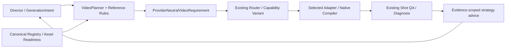

# Shot Reference Planning

## Ownership And Data Flow

Director 在既有 `generation.generation_intent.reference_planning` 中声明组合特征、视觉事件和参考职责。该字段随 `ProviderNeutralGenerationIntentProjection`、`VideoPlanningRequest`、neutral requirement 的既有 hashes 封存；不会新建 Production artifact 或 mutable lifecycle。历史数据重开、读取与 replay 不变，缺该字段时读取给出明确标注 `legacy_advisory` 的建议。

**新生成的声明义务（`reference_authoring.py`）。** 在 `GenerationDecisionExecutionBinding.create`（fresh creation，排在既有表演／commercial／Seedance 表达检查之后，保留原错误优先级；`GenerationFeedbackOrchestrator.prepare` 经此创建）检查，不在历史读取运行：缺 `reference_planning` 阻断；机位非 `locked` 时至少一个 `composition` event，用 `visual_state/purpose` 说明移动让观众看见什么（编译器随后要求其进入实际 prompt）；导演证据按领域分开：剧情须有 `director_coverage={coverage_hash, unit_id}`，且当前 Project 已供给时，该 hash 必须是 Project／Shot provenance 中封存的 content-addressed authoring input，bytes 经 `director_coverage.py` 结构校验并含该 unit；电商（`commercial_execution_class` 或 commercial binding）的导演层是 AdCreativePlan，执行绑定创建时须有含 `ad_creative_plan_hash` 的 commercial binding（由既有 commercial owners 核对计划），不得挂剧情 coverage。共享的 `reference_planning` 与机位 composition 义务两个领域都适用。程序只核对声明存在与证据一致，不判断镜头类型、参考数量、白模取舍或移动是否有戏；这些仍归 Director Skill。Canvas 项目经 `direction.director_coverages` 封存；非 Canvas 项目用 `reference_authoring.director_coverage_authoring_input()` 取得 artifact，随生成 Shot 的修订一起经 `ProductionStateCommitter` 提交，并把该引用写入 Shot `source_provenance`。Runtime 只做结构校验，不核对 coverage 由哪个 Skill 产出（作者检查只在 open-video 入口脚本）；门禁只读结构化 `primary_camera_motion`，仅写自由文本运镜不会触发 composition 义务。



Storyboard 继续拥有真实 Shot 顺序；`segment_ids` 只是一个生成单元内部的导演结构说明，不创建 Shot，不改 Storyboard 或 ResolvedTimeline。每次生成前的 authoring/selection freshness、预算、permit、egress、exact bytes 和唯一 committer 均沿原链。

## Semantic Inputs

`facets` 是可组合的正交特征：稳定、缓慢/复杂运镜、对白、情绪变化、多人调度、遮挡、高速动作、接触时序、连续物理因果、变形、消失、环境变化、产品准确性/旋转、精确图形、身份及空间准确性。类型来自 `ShotFacet`，扩展需同步规则和行为测试，不能用作品名或任意 Shot 名字作条件。

现有 typed camera、identity、scene、dialogue、performance beats 也会参与推导。各维度独立检查覆盖：表演事件不能替代空间走位事件，构图事件不能掩盖情绪节点缺失。自由文本不靠关键词猜分类；Director 负责把明确创作意图表达为结构化事实。缺失动作阶段或视觉状态时报告需求，不编造细节。

`events` 数组本身表示相对顺序；`phase=start/interior/end`、可选 `after_event_ids` 和可选 `at_seconds` 进一步约束。时间为空时保持为空；显式秒数不能逆序、非有限或超出当前 Shot。`control` 的职责是：

| Control | Use |
| --- | --- |
| `review_only` | 规划/审查关键状态，不要求上传该图；该事件的创作内容仍须在生成文本中表达 |
| `model_guidance` | 明确选图作为视觉引导，不声称精确时间绑定 |
| `endpoint` | 起/止帧控制；实际 variant 必须支持对应 role |
| `exact_time` | 要求严格时间绑定；当前 capability schema 无该能力，明确阻断 |

无固定图片上限或时间密度公式。稳定镜头可以零关键帧；缓慢运镜优先有差异的起止构图；情绪按可见角色的表演节点；走位保留空间/遮挡事件；变形/消失要求起止状态。接触、高速、物理因果、复杂运镜按下述组合风险决策，不再由单标签强制视频。只合并相邻、等价、非 required 且不被因果边依赖的 review 状态。

## Compositional Motion And Whitebox Decisions

`shot-reference-rules/2` 在同一 `ShotReferencePlan` 输出 motion 等级、理由与白模决策。
新增 `sustained_contact` 表达持续接触，`support_transfer` 表达承重/支撑关系转换；不能把普通触碰或改变姿势都标成这两项。
Director 的 `motion_reference_policy=required` 可声明确有必要的连续控制；默认 `auto` 序列化省略，保留原 intent hash 形状。

| Level | Combination | Consequence |
| --- | --- | --- |
| `none` | 稳定对白、单独触碰、静态状态变化 | 复用锚点、审查实际状态；不新增 motion duty，不做白模前置 |
| `recommended` | 单独高速、物理或复杂运镜；普通接触→受力但无其他耦合风险；显式选择的可选视频 | 可比较视频与静态方案；未选视频不阻断，选后仍严格核对 bytes/职责/Provider |
| `previs_priority` | 复杂摄影叠加空间/人物调度；持续受力或支撑转换叠加物理风险 | 优先审查可复用运动素材；没有时评估最小连续预演，建议本身不阻断 |
| `required` | 持续接触与支撑转换组合；接触→受力/碰撞因果链叠加高速或多人遮挡；Director 明确 required | 缺 motion reference 或所选模式不能承载时阻断，交回既有 Director/Provider Selection；不自动拆镜或换 Provider |

因果链按 `after_event_ids` 的传递关系检查，不只看直接相邻事件；画面状态数量仍由 `events` 决定。
这是确定性规划策略，不是经实验标定的模型质量评分。没有声明的事实不从自由文本猜测；复杂动作必须由 Director 表达实际关系。

`whitebox_decision=not_needed` 表示当前没有足以支持新增几何制作的组合约束；`optional_static` 表示静态布局/姿态/产品视角可能足够；
`reuse_motion_first` 表示先核对现成素材的动作、轴线、接触、摄影及源速度，缺适用素材时才制作可编辑 proxy 和连续 playblast。
选中素材不代表通过运动 QA，报告 `reuse_quality=NOT_EVALUATED`，必须回看 exact source。白模始终是备选控制手段，并非唯一 motion 来源。

## Reference Tradeoffs By Control Goal

下表为可组合的 Director 选择依据，不能单行变成强制规则。制作成本是相对工作量，不是 Provider 报价。

| Goal | Minimum Useful Reference | Higher Control And Cost | Failure Boundary |
| --- | --- | --- | --- |
| 身份/画风 | 复用各人物独立 identity，必要时 scoped style/lighting | 缺可见细节时补对应角度或特写，低至中成本 | 身份图不能保证表演；风格图不得带入另一角色/背景 |
| 对白/情绪 | 现有身份/场景和可观察表演节点，长对白可零新增图 | 只为难判断的情绪转折补审看图 | 口型、声音、自然反应须动态验收；不可一节点强制一图片 |
| 姿态/人体动作 | 入口、关键姿态、出口中真正不同的状态 | 连续复杂协调才评估 motion/previs，中至高成本 | 关键姿态不保证中间关节轨迹 |
| 多人走位/遮挡 | 定位布局、出入口和遮挡变化的少量状态 | 人物与摄影同时移动时优先空间预演 | 屏幕左右随反打可变，物理朝向和相对位置不可混淆 |
| 手/道具/受力 | 简单触碰可不补图；接触点不清才补状态 | 持续接触、承重转换叠加遮挡/高速时连续动作参考 | 首尾图不能证明抓住→受力→释放因果 |
| 高速/追逐/跌落 | 先确认实际起落点/路径和动作设计 | 高速接触碰撞链用合适视频，缺素材才做预演 | 单个高速标签不强制视频；模型仍可能慢动作或穿透 |
| 摄影/跟拍/环绕 | 已有构图锚点；需要时明确不同起止构图 | 摄影和主体调度耦合时连续 camera guide | 普通环绕不自动需要白模；不把端点等同完整摄影路径 |
| 消失/替代/变形 | 审看前后状态，必要时中间因果状态 | 只有过程轨迹重要时增加连续参考 | 有意变化不判成漂移；没有原生时间绑定就明确限制 |
| 产品/材质/旋转 | 复用 approved product/首帧，补真正未见的结构 | 已有合格3D优先复用；精确旋转可交受控动画 | 白模不含真实材质；产品结构/比例仍须 exact 输出核对 |
| 精确文字/图形 | 交现有 CompositionSpec/HyperFrames | 仅生成需要的背景/画面，图形独立后期 | 不要求视频模型重画字幕、Logo；后期交接仍由现有 owner 完成 |

20秒的复杂动作可有多个因果审看状态加一段 motion，而30秒稳定对白仍可零新增图片。二者都须先匹配所选渠道时长，不能把例子变成每秒配图公式。

## Reference Duties And Selection

| Logical role | Responsibility | Execution binding |
| --- | --- | --- |
| `identity` | 持久角色外观 | 当前 Character owner 的 identity reference |
| `product_object` | 商品/物体形状、结构、材质 | 显式 image reference，或当前商业需求已审批的 canonical first frame；不新增第二张商品图 |
| `scene_environment` | 环境与空间连续性 | 当前 Scene 的 reference |
| `style_lighting` | 画风、材质、光照 | 显式 scoped image reference |
| `composition` | 构图、摄影角度、主体布局 | 显式 scoped image reference |
| `temporal_keyframe` | Shot 内视觉状态 | review、reference 或 first/last frame |
| `action_pose` | 动作姿态与关键接触状态 | 静态姿态只辅助视觉锚定，不能取代 motion |
| `motion_camera_video` | 连续动作/运镜轨迹 | 原有 `video_reference`，必须明确分配用途 |
| `physical_previsualization` | 3D/白模/物理预演准备需求 | preparation 建议；制作后仍经既有视频导入与 reference 链 |
| `postproduction_graphics` | 精确文字、Logo、图形动画 | 交现有 CompositionSpec/HyperFrames owner |

逻辑职责不扩充 Registry 的资产类型或 Provider 原生角色。`anchors` 明确持久参考的 `anchor_id/role/purpose/owner_id/priority`；`selections` 将 `need_id` 映射到 `asset_id`，实际 SHA/owner/revision/bytes 从既有来源校验。

身份和场景若只有一个匹配 canonical owner 的候选可自动选择；同 owner 有多个候选时要求明确选择。额外可用图片不会自动填满 Provider 容量。Video 素材存在本身不证明适合控制当前动作，motion duty 需要显式选择。静态图 MIME、角色不可能满足 motion need；不同独立角色复用同一图片字节会报告冲突。普通 semantic roles/media selection 仍受到原验证限制，explicit media IDs 不被静默丢弃。

## Director Example

以下为既有 Canvas Director row 中 `generation` 的局部内容；其他必需的 output/audio/quality/Shot 字段仍由原合同定义。所有 asset IDs 必须已经通过 Registry 导入与当前 owner 验证。

```json
{
  "references": [{"role": "existing_video", "asset_id": "action-guide"}],
  "generation_intent": {
    "subject_action": {"progression": "先握紧扶手，再由扶手带动身体，最后稳定站立"},
    "reference_planning": {
      "facets": ["contact_timing", "continuous_physics"],
      "structure": "continuous",
      "events": [
        {"event_id": "grip", "kind": "contact", "phase": "start", "visual_state": "手握紧扶手，双脚着地", "purpose": "先建立接触"},
        {"event_id": "lift", "kind": "force", "visual_state": "扶手带动身体上移", "purpose": "受力发生在握紧之后", "after_event_ids": ["grip"]},
        {"event_id": "settle", "kind": "composition", "phase": "end", "visual_state": "身体稳定站立", "purpose": "保留完整动作反应", "after_event_ids": ["lift"]}
      ],
      "selections": [{"need_id": "auto:motion", "asset_id": "action-guide"}]
    }
  }
}
```

此例规划三个审查状态和一项显式选择的可选连续 motion duty，但执行只选一个视频；不会强制绘制或上传三张图。需要硬性连续控制时由实际组合风险或 `motion_reference_policy=required` 声明。现有 adapter 的 native text 必须表达事件 `visual_state/purpose`；编译器拒绝遗漏。参考素材只是 guidance，真实接触顺序仍需 exact MP4 的逐 Shot Gate 验证。

## Execution And Unsupported Controls

`VideoPlanner.plan(...).reference_plan` 提供派生报告；`canvas_reference_preflight()` 在素材准备阶段显示需求；`prepared_generation_report()` 显示已选素材、实际 variant、execution gaps 和未验证质量。报告不会写状态，也不是 acceptance receipt。

`image_preparation` 区分 `review_only_state_ids`、model-image duties 与尚未绑定的 duty。`new_image_count_if_no_reuse` 是无法复用时逐职责准备候选的条件数量，不是自动制图指令；可兼容的共享锚点会减少数量，无法从文字确定的 review state 不默认新增图片。
`minimum_viable_plan` 列出必须满足的输入；`higher_control_plan` 保留可选控制；各自的 `need_ids` 回指唯一 needs 清单中的职责与风险。
`planned_model_inputs` 是 neutral requirement 中已准备的素材，`actual_model_inputs` 仅在 exact compiled request 存在时显示真实 binding，否则 `NOT_EVALUATED`。
selected capability 直接投影现有 variant，不维护第二张能力表；selected profile/model/mode/channel 和 native 参数仍见同一 prepared report 的 `selected_route/references/native_parameters/router_assessments`。

新声明会实际改变 Planner 选图、生成 mode、BLOCKED 结果和 requirement。Router 用已有 `VideoCapabilityVariant` 的模式、image roles、media support、数量及 cardinality 规则判断，不使用第二能力注册表；compiler 再检查语义执行条件与 native 表达。没有匹配能力时没有降级成功。

当前未声明中间帧时间绑定或 native 多镜头切换能力，因此这些控制停在明确能力缺口。`multi_shot` 保留完整内部事件与镜头段结构，不能冒充已执行切镜；由 Director 判断采用现有多个 Storyboard Shots 或更合适的能力。continuous 不因时长或失败自动拆开。

精确图形会生成 `COMPOSITION_HANDOFF_REQUIRED` 并阻断该 raw-video requirement。上层须通过现有 Production responsibility/strategy owner 分配背景生成与图形合成任务；本层不擅自生成 CompositionSpec、不创建合成完成证明，也不把文字精度需求交给视频模型。相同边界适用于需要 3D 资产的新准备工作。

## QA Feedback And Compatibility

既有 diagnosis 的 failed requirement IDs、intent paths、rubric、source evidence 决定建议。先对照 exact 视频/QA 区间、参考 bytes、actual native roles/order 和 prompt，再区分参考不足、参考属性冲突、模型/模式能力、文字遗漏、动作/导演设计、剪辑源时序。身份漂移指向 identity anchor，表演失败指向表演节点，动作/时间失败评估连续视频/预演，空间失败检查 blocking；不把这些候选建议当作已证实根因。保留 passing requirements，一次修正可归因变量，不默认加图。`unknown_outcome` 只提示 canonical recovery，缺证只补证。建议不是 retry permit，也不自动改 prompt、rubric、素材或历史。

新字段缺省时序列化省略，旧 request/projection/requirement hashes 与 legacy v2 Planner 不变；显式新声明参与原 seals，修改事件使旧 plan 过期。没有自动迁移历史数据。静态图及 image-motion 的既有最终视觉素材继续由原策略选择，不能因无新增参考需求而被过滤；多角色身份按每个 canonical owner 分别满足。

## Verification Boundary

`tests/test_reference_planning.py` 覆盖组合语义、数量、时序、职责、选择、历史兼容和失败建议；`tests/test_reference_planning_integration.py` 经过真实 Canvas authoring、ProductionStateCommitter、loader、Planner、readiness、Router 和 compiler，使用 fake Provider，检查不发生 submit/fetch。

工程测试只证明上述确定性行为。电影、电视剧、漫剧、广告、产品展示和片头共享规则维度，不以某个模型、作品、单镜或已有失败命名规则。没有真实生成实验，模型最终画面、物理因果和人工观看验收均为 `NOT_EVALUATED`。
