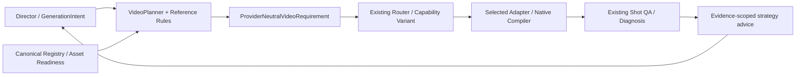

# Shot Reference Planning

## Ownership And Data Flow

Director 在既有 `generation.generation_intent.reference_planning` 中声明组合特征、视觉事件和参考职责。该字段随 `ProviderNeutralGenerationIntentProjection`、`VideoPlanningRequest`、neutral requirement 的既有 hashes 封存；不会新建 Production artifact 或 mutable lifecycle。未提供该字段的历史数据继续原执行行为，读取时给出明确标注 `legacy_advisory` 的建议。



Storyboard 继续拥有真实 Shot 顺序；`segment_ids` 只是一个生成单元内部的导演结构说明，不创建 Shot，不改 Storyboard 或 ResolvedTimeline。每次生成前的 authoring/selection freshness、预算、permit、egress、exact bytes 和唯一 committer 均沿原链。

## Semantic Inputs

`facets` 是可组合的正交特征：稳定、缓慢/复杂运镜、对白、情绪变化、多人调度、遮挡、高速动作、接触时序、连续物理因果、变形、消失、环境变化、产品准确性/旋转、精确图形、身份及空间准确性。类型来自 `ShotFacet`，扩展需同步规则和行为测试，不能用作品名或任意 Shot 名字作条件。

现有 typed camera、identity、scene、dialogue、performance beats 也会参与推导。各维度独立检查覆盖：表演事件不能替代空间走位事件，构图事件不能掩盖情绪节点缺失。自由文本不靠关键词猜分类；Director 负责把明确创作意图表达为结构化事实。缺失动作阶段或视觉状态时报告需求，不编造细节。

`events` 数组本身表示相对顺序；`phase=start/interior/end`、可选 `after_event_ids` 和可选 `at_seconds` 进一步约束。时间为空时保持为空；显式秒数不能逆序、非有限或超出当前 Shot。`control` 的职责是：

| Control | Use |
| --- | --- |
| `review_only` | 规划/审查关键状态，不要求上传该图；该事件的创作内容仍须在生成文本中表达 |
| `model_guidance` | 明确选图作为视觉引导，不声称精确时间绑定 |
| `endpoint` | 起/止帧控制；实际 variant 必须支持对应 role |
| `exact_time` | 要求严格时间绑定；当前 capability schema 无该能力，明确阻断 |

无固定图片上限或时间密度公式。稳定镜头可以零关键帧；缓慢运镜优先有差异的起止构图；情绪按可见角色的表演节点；走位保留空间/遮挡事件；变形/消失要求起止状态；接触/高速/物理因果/复杂运镜生成独立 motion-video 需求。只合并相邻、等价、非 required 且不被因果边依赖的 review 状态。

## Reference Duties And Selection

| Logical role | Responsibility | Execution binding |
| --- | --- | --- |
| `identity` | 持久角色外观 | 当前 Character owner 的 identity reference |
| `product_object` | 商品/物体形状、结构、材质 | 显式 image reference，或当前商业需求已审批的 canonical first frame；不新增第二张商品图 |
| `scene_environment` | 环境与空间连续性 | 当前 Scene 的 reference |
| `style_lighting` | 画风、材质、光照 | 显式 scoped image reference |
| `composition` | 构图、摄影角度、主体布局 | 显式 scoped image reference |
| `temporal_keyframe` | Shot 内视觉状态 | review、reference 或 first/last frame |
| `action_pose` | 动作姿态与关键接触状态 | 静态姿态只辅助视觉锚定，不能取代 motion |
| `motion_camera_video` | 连续动作/运镜轨迹 | 原有 `video_reference`，必须明确分配用途 |
| `physical_previsualization` | 3D/白模/物理预演准备需求 | preparation 建议；制作后仍经既有视频导入与 reference 链 |
| `postproduction_graphics` | 精确文字、Logo、图形动画 | 交现有 CompositionSpec/HyperFrames owner |

逻辑职责不扩充 Registry 的资产类型或 Provider 原生角色。`anchors` 明确持久参考的 `anchor_id/role/purpose/owner_id/priority`；`selections` 将 `need_id` 映射到 `asset_id`，实际 SHA/owner/revision/bytes 从既有来源校验。

身份和场景若只有一个匹配 canonical owner 的候选可自动选择；同 owner 有多个候选时要求明确选择。额外可用图片不会自动填满 Provider 容量。Video 素材存在本身不证明适合控制当前动作，motion duty 需要显式选择。静态图 MIME、角色不可能满足 motion need；不同独立角色复用同一图片字节会报告冲突。普通 semantic roles/media selection 仍受到原验证限制，explicit media IDs 不被静默丢弃。

## Director Example

以下为既有 Canvas Director row 中 `generation` 的局部内容；其他必需的 output/audio/quality/Shot 字段仍由原合同定义。所有 asset IDs 必须已经通过 Registry 导入与当前 owner 验证。

```json
{
  "references": [{"role": "existing_video", "asset_id": "action-guide"}],
  "generation_intent": {
    "subject_action": {"progression": "先握紧扶手，再由扶手带动身体，最后稳定站立"},
    "reference_planning": {
      "facets": ["contact_timing", "continuous_physics"],
      "structure": "continuous",
      "events": [
        {"event_id": "grip", "kind": "contact", "phase": "start", "visual_state": "手握紧扶手，双脚着地", "purpose": "先建立接触"},
        {"event_id": "lift", "kind": "force", "visual_state": "扶手带动身体上移", "purpose": "受力发生在握紧之后", "after_event_ids": ["grip"]},
        {"event_id": "settle", "kind": "composition", "phase": "end", "visual_state": "身体稳定站立", "purpose": "保留完整动作反应", "after_event_ids": ["lift"]}
      ],
      "selections": [{"need_id": "auto:motion", "asset_id": "action-guide"}]
    }
  }
}
```

此例规划三张审查状态图和一项连续 motion duty，但执行只选一个视频；不会强制上传三张图。现有 adapter 的 native text 必须表达事件 `visual_state/purpose`；编译器拒绝遗漏。参考素材只是 guidance，真实接触顺序仍需 exact MP4 的逐 Shot Gate 验证。

## Execution And Unsupported Controls

`VideoPlanner.plan(...).reference_plan` 提供派生报告；`canvas_reference_preflight()` 在素材准备阶段显示需求；`prepared_generation_report()` 显示已选素材、实际 variant、execution gaps 和未验证质量。报告不会写状态，也不是 acceptance receipt。

新声明会实际改变 Planner 选图、生成 mode、BLOCKED 结果和 requirement。Router 用已有 `VideoCapabilityVariant` 的模式、image roles、media support、数量及 cardinality 规则判断，不使用第二能力注册表；compiler 再检查语义执行条件与 native 表达。没有匹配能力时没有降级成功。

当前未声明中间帧时间绑定或 native 多镜头切换能力，因此这些控制停在明确能力缺口。`multi_shot` 保留完整内部事件与镜头段结构，不能冒充已执行切镜；由 Director 判断采用现有多个 Storyboard Shots 或更合适的能力。continuous 不因时长或失败自动拆开。

精确图形会生成 `COMPOSITION_HANDOFF_REQUIRED` 并阻断该 raw-video requirement。上层须通过现有 Production responsibility/strategy owner 分配背景生成与图形合成任务；本层不擅自生成 CompositionSpec、不创建合成完成证明，也不把文字精度需求交给视频模型。相同边界适用于需要 3D 资产的新准备工作。

## QA Feedback And Compatibility

既有 diagnosis 的 failed requirement IDs、intent paths、rubric、source evidence 决定建议。身份漂移指向 identity anchor，表演失败指向表演节点，动作/时间失败指向连续视频/预演，空间失败指向 blocking；保留 passing requirements。`unknown_outcome` 只提示 canonical recovery，缺证只补证。建议不是 retry permit，也不自动改 prompt、rubric、素材或历史。

新字段缺省时序列化省略，旧 request/projection/requirement hashes 与 legacy v2 Planner 不变；显式新声明参与原 seals，修改事件使旧 plan 过期。没有自动迁移历史数据。静态图及 image-motion 的既有最终视觉素材继续由原策略选择，不能因无新增参考需求而被过滤；多角色身份按每个 canonical owner 分别满足。

## Verification Boundary

`tests/test_reference_planning.py` 覆盖组合语义、数量、时序、职责、选择、历史兼容和失败建议；`tests/test_reference_planning_integration.py` 经过真实 Canvas authoring、ProductionStateCommitter、loader、Planner、readiness、Router 和 compiler，使用 fake Provider，检查不发生 submit/fetch。

工程测试只证明上述确定性行为。电影、电视剧、漫剧、广告、产品展示和片头共享规则维度，不以某个模型、作品、单镜或已有失败命名规则。没有真实生成实验，模型最终画面、物理因果和人工观看验收均为 `NOT_EVALUATED`。
