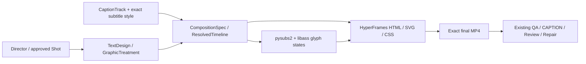

# Text Visual Authoring And Rendering

## Architecture

Director 从场景/叙事、角色关系、构图、镜头运动或品牌目标决定是否需要文字及其视觉语言。运行时没有另一个“自动专业设计”服务，也不会把标题自动塞进预设卡片。Director 交付可审核的意图、层次、字体、空间组织及运动；compiler 只执行，不改文案、不猜字幕时间，不签质量。



HyperFrames 仍是唯一最终 renderer。libass 是字幕字形 rasterizer，返回透明 PNG 编译产物；不会生成另一份成片、timeline、Registry 或 Manifest。`ProductionStateCommitter` 仍独占状态与激活，渲染不等于 P6 acceptance。

## Director Handoff

先依据 actual source frame / camera 与叙事决定阅读顺序及出现时机，再填写类型。不要从一个大文本块开始“调好看”，也不要把本次样片的字号、配色和位置升级成默认模板。需要保留：

- `intent` / `hierarchy`：为什么用文字、观众先读什么、文字与画面如何分工；不需要文字时留空图层集合。
- 独立 `nodes` 与 `runs`：标题、副标题、价格/单位、章节/署名等可以采用不同字体、字重、字距和基线；vector path 提供排版所需的线条/图形。primitive 的种类是执行边界，作品风格/角色含义写自由文本。
- `motion`：每层独立 keyframes、Bezier easing、opacity、translation、rotation、scale、blur 和 inset reveal，可组合出新表达；不是预设入场名称。关键帧相对于既有 graphic window，第一 pose 为 0，最后一 pose 后保持。
- 字体与几何：提供允许嵌入的 standalone TTF/OTF exact bytes、family、SHA-256、license；所有实际字形必须存在。明确 safe area 与主体避让几何。需要随摄影机变化避让时声明覆盖运动范围的保守 region；当前没有自动人脸/商品跟踪，不把 avoidance ID 当成真实测量。
- 审片目标：准确文案、中文禁则/换行、字体和层次、主体不被遮挡、实际出现/退出帧、运动节奏以及完整声画体验。静态 layout PASS 不能证明这些全部成立。

主体避让检查使用 declared canvas / swept bounds，能拒绝已声明的几何冲突；它不能验证未声明的人脸、真实 glyph overflow 或画面内生成文字。旋转使用保守外接范围，当前 avoidance 以整个 swept path 作保守检查，可能拒绝时间上分离的布局；这时显式拆分图层窗口，而非伪造 region 或关闭检查。

## Production APIs

通用文字用 `CompositionSpec.text_layers`（2.2 / 2.3 / 2.4）或：

```python
spec, timeline = canvas_service.compose(text_layers=(treatment,))
canvas_service.render(
    attempt_id="new-exact-render-attempt",
    toolchain=explicit_local_renderer_tools,
    text_layers=(treatment,),
)
```

`treatment` 为现有 `GraphicTreatment`，新增可选 `text_design: TextDesign`；JSON payload 也可走 compose。`TextDesign.text` 按 nodes / runs 的阅读次序与 `GraphicTreatment.text` 精确相等，避免渲染文案和审核文案脱节。外层字段继续绑定 Shot/window、安全边界、z-index；采用 design 时旧 `entrance/exit` 必须 `NONE`，避免两套运动互相叠加。

`text_layers` 是通用排版的 composition 输入，禁止携带 caption binding、typed claim、brand token 或 synchronized advertising sound 字段。涉及商品事实、商业来源/功效声明与广告计划的制作继续使用 `AdCreativePlanProposal.graphic_treatments → compile_ad_creative_plan → CompositionSpec.commercial_graphics`，不拿通用字段绕过广告 authoring。电影片名/章节无需伪造广告计划。两条 authoring 输入共用同一 effect contract、resolver、compiler 与最终 timeline，跨集合 ID 必须唯一。

旧 `GraphicTreatment` 未提供 `text_design` 时原 CSS 行为保持；新增空字段不进入旧序列化与 fingerprint。通用字段也使用同一旧路径提供精确 baseline，不复制维护另一份 legacy renderer。已有广告 compiler 自动携带非空 design；旧作品无须迁移。

## Subtitle Backend

`CaptionTrack` 继续保存原文、segment、word timing 和来源；样式走原有 content-addressed `CaptionStyleReference`。旧 `schema_version="1"` 保留 HTML/CSS 行为。新样式 `SubtitleDesign` 使用 `schema_version="2"` / `engine="libass"`：

```python
from ai_video.production.subtitle_ass import SubtitleDesign, SubtitleLineStyle, libass_version

design = SubtitleDesign(
    libass_version=libass_version(),
    fonts=(exact_embedded_font,),
    font_family=exact_embedded_font.family,
    font_size_px=46,
    margin_vertical_px=100,
    line_styles=(SubtitleLineStyle(line_index=1, font_size_px=30),),
    intent="中文对白主导，英文译文退后；不覆盖人物表演",
)
# Serialize this design through the existing caption-style import/binding owner.
```

支持对白/旁白、双语逐行样式、字体/颜色/描边/阴影/字距、ASS 对齐与 margins / wrap width。源文本中的 ASS 控制内容按字面处理，不能注入 override 执行任意位置；不接收原始 ASS 作为第二时序。复杂片名、章节与署名的运动用通用 TextDesign。

`SubtitleLineStyle` 仅覆盖逐行字体与字形样式；对齐、margins、wrap width 属于整个 cue。ASS 的一个多行 event 不能靠 style reset 实现独立行定位，逐行定位字段会明确拒绝。需要不同位置时使用独立 CaptionSegments 或通用 TextDesign。字面反斜杠通过内部零宽 WORD JOINER 隔开 ASS 控制前缀，真实 raster 测试确认控制字母及符号保留。

`word_highlight=true` 要求 canonical `CaptionSegment.words`，各 word 文本必须精确拼成 cue 文本；缺时间、缺字、版本不符或不支持的字符时停止。`_composition_text.resolve_caption_words` 在既有 resolver 内以 sample time 投影到 frame：word 从第一个不早于其 start sample 的帧开始，end exclusive；短于一帧的词可没有可见帧，不伪造延时。Renderer 只消费已解析帧，词间空隙显示普通字色。改变 word timing 或 text design 会改变 timeline fingerprint 并走原有失效/重审路径。

## Reproducibility And Source Audit

字体检查用 fontTools 复用字体表，不依赖当前 OS 的替代字体。广告/标题的 exact font bytes 编译为 CSS font data URI；字幕用 `ASS_FONTPROVIDER_NONE`，只加载嵌入字体。当前同一 family 在一个 composition 内只能绑定一份字节；需要多字重时使用独立可验证 family/face，或明确评估浏览器的合成字重，不声称合成字重是独立原始字体。

PNG/font data URI 只在重建的 exact compiler source 中准入；source audit 比较完整 document、CSS、timing、URLs、style/track bytes 和 source bundle hash。任意修改内联字体或 PNG 都不能通过审计。允许的数据 URI 不放行其他 scheme、脚本、网络、外链字体或手写任意 HTML。旧 style-v1 source compatibility 不能降级 style-v2 字幕。

封存 libass API version、pysubs2 pin、字体 bytes 与派生 source/MP4 identity。libass 的同版本不同原生依赖构建仍可能改变 raster pixels；重开时 source reconstruction 会拒绝差异。版本号不是跨平台 bit-exact 保证，部署需固定 libass / FreeType / HarfBuzz 的实际构建；不要靠更换 runtime 跳过旧来源核验。

内联字形状态避免派生文件成为第二权威，但 source 会随字幕数量/词状态增长。实现有 cue / word / pixel / output bounds 和有限缓存；长片应先测 source size、内存与整片 render。当前没有宣称长片吞吐或多小时演职员滚动字幕已经 qualified。

## Installation And Native Runtime

可选依赖：`uv pip install --python .venv/bin/python '.[text]'`。固定 `pysubs2==1.8.0` 保持 Python 3.11 兼容（1.9 要求 3.12）；fontTools 固定 4.67.0。libass 由部署提供，样式明确封存 `ass_library_version()`。

本机 `.venv` 使用 Conda Python，Conda FreeType 与系统 libass/Harfbuzz 产生 `FT_Get_Transform` 冲突；实测以下显式 runtime 配置可用：

```bash
LD_PRELOAD=/lib/x86_64-linux-gnu/libfreetype.so.6 python -m pytest \
  -p no:cacheprovider tests/test_production_subtitle_ass.py -q
```

这是当前 host 的配置，不是产品自动 fallback。标准 system-Python / 同源原生依赖部署自行核验；不把上述路径变成通用硬编码默认值。依赖和原生库不可用时返回明确失败，不自动换字幕引擎。

## QA And Repair

保留既有 CAPTION 六组、LAYOUT、SEMANTIC 与 P6 transaction。通用图层文案和 design identity 进入 caption context 的 approved non-caption text，避免将合法片名误判为意外字幕；这不自动裁决其美感。Exact render hash / timeline / policy / graph 的 freshness 绑定不变。

按实际失败归因：

| Observation | Owner / response |
| --- | --- |
| 缺字、裁切、错帧、错误的 source projection、色彩/alpha 合成不正确 | renderer / resolver 能力或实现；修源码或适配，并对 exact 新片重验 |
| 信息主次不清、文字遮住表演、错误颜色/节奏/构图 | Director / design 决策；修 authoring revision，不把引擎无报错当 PASS |
| Agent 在明确来源、约束与设计工具可用时仍反复产出低质量方案 | model creative capability 尚未证明；用共同 brief、独立设计者方案和可比成片验证，不在运行时堆 genre 硬编码掩盖 |

已批准 repair 仍由现有 Review / Repair / committer 根据 exact closure 执行，重渲染后取 fresh reviews。不修改已验收 receipt，不以 subtitle raster、source check 或测试成功代签人类观看/听音。

## Real Pilot

`tests/test_production_text_visual_render.py` 为 opt-in 真实本地集成验证：经已存在 Canvas 资产导入、author/approve、caption import、compose、render、deliver 及 durable reopen；没有 fake runner、付费 submit 或新模型生成。测试中的具体视觉设计只用于可审核样片，不是产品内置模板。项目资产限内部对照，不代表重新确认商业发布权利。

```bash
LD_PRELOAD=/lib/x86_64-linux-gnu/libfreetype.so.6 \
AI_VIDEO_TEXT_PILOT=1 AI_VIDEO_TEXT_PILOT_ROOT=/absolute/new/pilot-root \
python -m pytest -p no:cacheprovider tests/test_production_text_visual_render.py -q
```

每次使用新的 root，保留失败 artifact / Manifest，不盲重试未知 render。输出 `pilot-evidence.json` 记录 source/output SHA、timeline fingerprint 和实际耗时；完整 P6 / human acceptance 明确保留 `NOT_EVALUATED`。当前结果、观看路径与诊断见本任务 session record，技术选型/许可证的 primary sources 见 [research](research/2026-10-21-text-visual-engines.md)。
