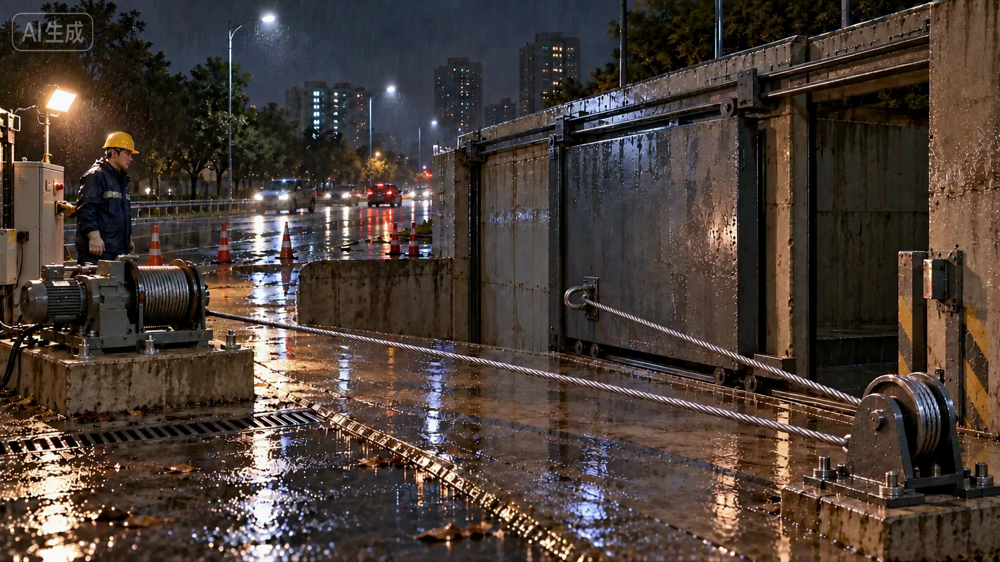
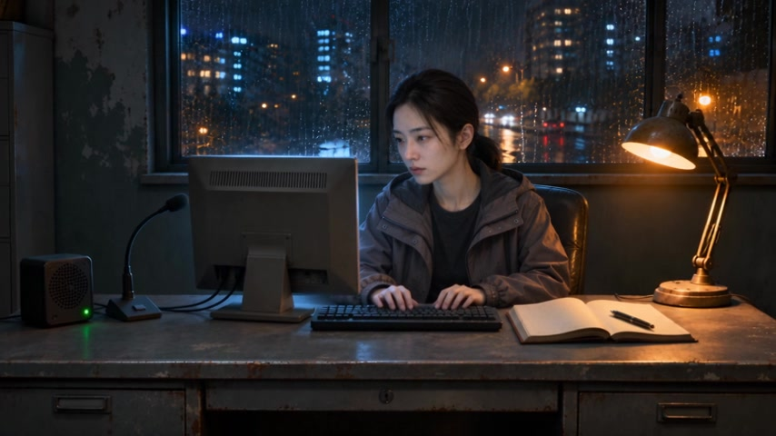
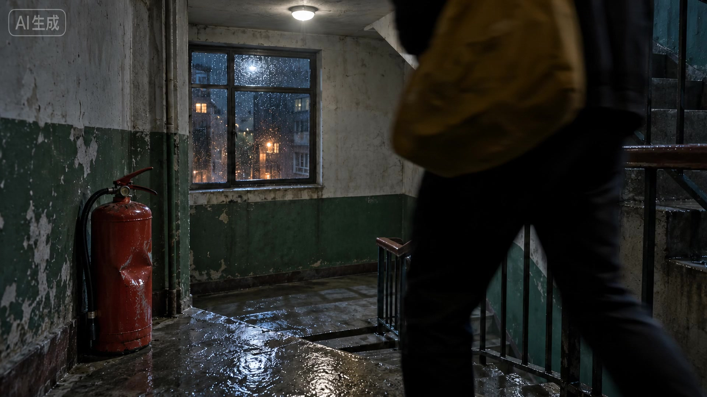
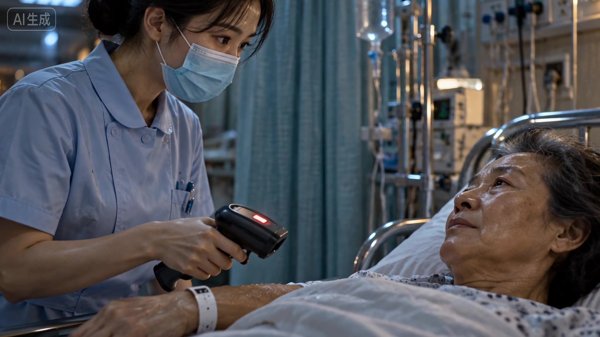
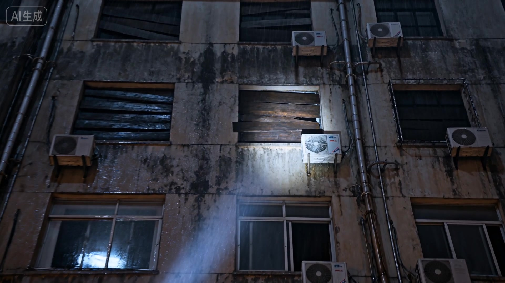
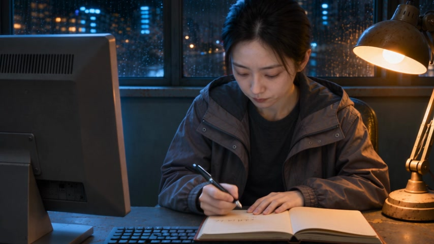
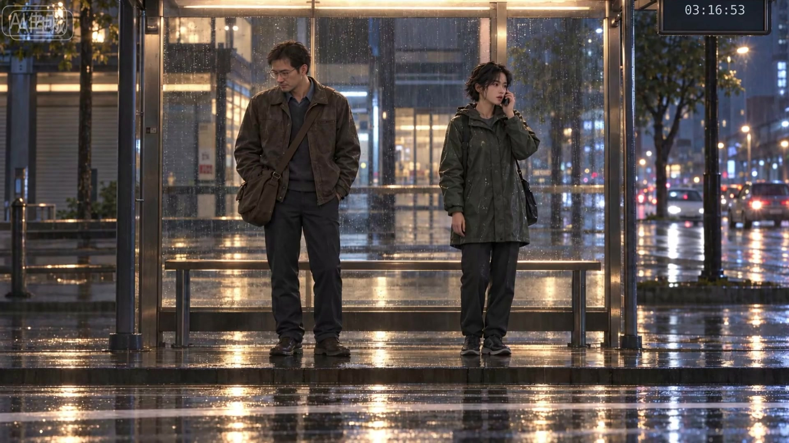
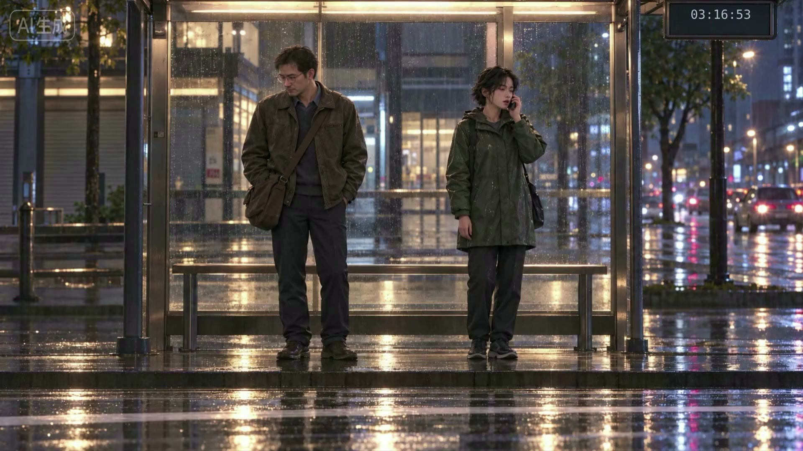

# Shizhen Opening — Awesome Seedance Review

状态：**待审制作方案；非新成片；本轮视频生成0次、生图0次。**

## Goal And Protected Scope

本轮目标是用 awesome-seedance 方法完成《失帧》的完整宏观开头，不是12秒虚构调度员试镜。完整顺序：市政 → D1 → D2 → D3 → D4 → D5 → D6 → B6。当前尚未收到扩大到全部重做的回答。

保留已认可市政、B6及七句母带声音。调度表演保持平淡、日常，越平淡越不安；不引入新人物、新台词或惊恐表演。各现场通过可见证据支撑对讲，不靠炫技运镜补吸引力。旧素材的局部认可不等于新组装认可。

母带用户原话“声音可以，剪辑保住”只认可七句声音及限定D1/D5安全画面；麦克风缺失、溶接和点名动作失败保留。来源：`master-references-v1/qa/user-decision-salvage.json`。本页没有新用户认可，也没有签发preview_approval。

## Method And Practical Changes

来源：[LearnPrompt/awesome-seedance固定版本](https://github.com/LearnPrompt/awesome-seedance/tree/67df3707a4f25f860088790fb0a74d8f99a50cbb/agents/skills/seedance-production-workflow)，重点为SKILL.md、references/editable-template.md及qa-rubric.md。用自己的话组织方法，不复制完整案例prompt。

1. 用每镜进入/退出状态定位具体缺口，而非笼统“加强一致性”。
2. 给参考明确控制属性与不继承属性；场景/身份/动作指导分工，不把多张图视为自动按顺序执行。
3. 先保留已成立素材与声音，再把失败映射到具体画面、音效或接点；不为换Skill重抽全片。
4. 以实际对白长度决定采用窗口，保留观众看清证据的时间；分镜旧时长和粗剪时长均不是新封存时间线。
5. 各项缺陷不能由总分抵消。实际提交继续走既有Provider、预算和一次性permit；组装走CompositionSpec → ResolvedTimeline → HyperFrames，逐镜与整片声画检查沿现有owner。

本次只取旧素材实际帧形成定位板，静帧不能证明运动、声音、情绪或衔接通过；本方法尚无本项目增益证明。宫格供人审看，不直接作为视频首帧或一套强制模型输入。

## Shot Plan

### municipal — 市政异常

- **状态：** 市政作业 → 铁门撞限位、钢索仍受力
- **现有素材：** 已认可市政原片，保留完整画面和原声。
- **具体处理：** 七句母带第一句做 J-cut；以实际对讲结尾决定进入 D1 的接点，不改市政原片。
- **参考需求：** 原片为风格及事件事实来源；不新增图片或生成。
- **待修/复检：** 核对第一句报告确与绞盘异常对应；新增混音不盖住关键现场声。
- **新生成与认可：** 无需新生成；新增组装仍需整片审看。
- **来源：** `outputs/shizhen-episode01/macro-opening-video-20261027/MC01-02-edit-v4/失帧-市政异常-1080p-剪辑修订04.mp4`；SHA256 `b3d5a404eaf19453081309754ad11b997725d81130973a991530a78ff663f05d`；请求取帧时间 `0s`。

### D1 — 记录台接报

- **状态：** 静听报告 → 听完开始记录
- **现有素材：** 母带声音已认可；D1 可用画面范围 0–4.5 秒。
- **具体处理：** 只用许可源窗内的听完/敲键盘动作承接 J-cut，不能把键盘声提前混入市政。
- **参考需求：** 母带实际画面锚定董文慧身份和记录台，不能把候选图替代真实源状态。
- **待修/复检：** 逐帧核对采用出点，镜头内动作应成立；480p 原始画质不会因放大变成原生1080p。
- **新生成与认可：** 优先复用；若需要新画面，先展示该镜实际参考并取得新认可。
- **来源：** `runs/shizhen-opening-dispatch-20261104/M1-r11/state/video-generation/fetch/files/9a776d418aff76d3da97c9e37677780e5c39931b852028ed7def612b186d2fa0.mp4`；SHA256 `9a776d418aff76d3da97c9e37677780e5c39931b852028ed7def612b186d2fa0`；请求取帧时间 `3.4s`。

### D2 — 楼梯回层

- **状态：** 同一住户向下离画 → 从上方同一楼梯返回同一灭火器前
- **现有素材：** 旧 D2r1 候选，未据此取得新用户认可。
- **具体处理：** 把进入/退出方向写成可核对的空间关系。旧 r1 “右前景返回”与原设计“上方返回”存在差异，先核对而非直接宣布循环成立。
- **参考需求：** 以凹陷红灭火器、黄色帆布包与楼梯路径为锚点；若重做，提供干净起点和路径审看图，图区分身份/空间职责。
- **待修/复检：** 必须看懂是同一人回到原层，不是正常下楼或另一个入口出现；旧PASS仅历史判断。
- **新生成与认可：** 只在旧片无法满足时局部新生成；新参考、路线与镜头方案须先认可。
- **来源：** `runs/shizhen-opening-dispatch-20261030/D2r1/state/video-generation/fetch/files/5946ddfe72ebac4e5dbf088f34022d24f574d36870db6fa60bcd7ab78ce6af1a.mp4`；SHA256 `5946ddfe72ebac4e5dbf088f34022d24f574d36870db6fa60bcd7ab78ce6af1a`；请求取帧时间 `3.5s`。

### D3 — 急诊登记异常

- **状态：** 护士举扫码器 → 红灯两次 → 抬眼看仍睁眼呼吸的病人
- **现有素材：** 旧 D3 候选；历史记载护士未明确抬眼、开头有特写切点。
- **具体处理：** 分开核对扫描反馈与人物反应两条证据；不能让画外报告替代护士抬眼，也不因红灯出现就判整镜通过。
- **参考需求：** 需要手环/扫码器接触关系、红灯可见性、护士与病人的视线；原场景候选仅供定位，若补图须保留身份与方位。
- **待修/复检：** 确认两次红灯与病人活着同镜可读；确认抬眼反应及开头切镜是否服务表达。
- **新生成与认可：** 先检查可用源窗；不足时仅重做此镜，新参考须先认可。
- **来源：** `runs/shizhen-opening-dispatch-20261030/D3/state/video-generation/fetch/files/b312bba5ba817919f045fc4266469a77e93eb5b901d967332256210f76ccf85f.mp4`；SHA256 `b312bba5ba817919f045fc4266469a77e93eb5b901d967332256210f76ccf85f`；请求取帧时间 `4s`。

### D4 — 封死的七楼

- **状态：** 手电沿外墙逐层上移 → 停封死七楼窗 → 木板后轻声呼救
- **现有素材：** 旧 D4r1 候选；两次视频均没有需要的“救命”。
- **具体处理：** 将视觉定位与缺失声音分别处理：画面若成立则保留，只补木板后轻声呼救并检验位置/时机，不为缺声音重抽整镜。
- **参考需求：** 旧楼外墙层数、封窗位置和手电轨迹；新增声音要对应窗后空间，沿已有音频制作入口。
- **待修/复检：** 逐层上摇是否可数到七楼；不能仅推近。呼救在报告后可听，不能被对讲淹没。
- **新生成与认可：** 若只补声无需新视频；视觉不成立才另提局部参考与生成，先认可。
- **来源：** `runs/shizhen-opening-dispatch-20261030/D4r1/state/video-generation/fetch/files/f9eb9fefe358566f1c97881bdfad84a3f730534198b0b9c0f7b2c1f1900acb67.mp4`；SHA256 `f9eb9fefe358566f1c97881bdfad84a3f730534198b0b9c0f7b2c1f1900acb67`；请求取帧时间 `5s`。

### D5 — 记录台计数

- **状态：** 写下一行 → 笔停；平淡低声“记上，第十四起”
- **现有素材：** 认可声音；画面许可约20.6–23.8秒，须再查麦克风缺失可见性。
- **具体处理：** 按明确源窗核验完整写字/停笔与空间。旧粗剪19.8–23.9秒不是扩大许可的依据；不机械沿用。
- **参考需求：** 复用母带人物、记录本和真实姿态；如空间缺失暴露，先报告是否需独立补画面。
- **待修/复检：** 不裁掉笔停或必要面部来遮缺陷；不新增惊恐表演，仍是日常调度语气。
- **新生成与认可：** 优先复用许可区间；必要新画面须新参考认可，不重抽已认可声音。
- **来源：** `runs/shizhen-opening-dispatch-20261104/M1-r11/state/video-generation/fetch/files/9a776d418aff76d3da97c9e37677780e5c39931b852028ed7def612b186d2fa0.mp4`；SHA256 `9a776d418aff76d3da97c9e37677780e5c39931b852028ed7def612b186d2fa0`；请求取帧时间 `21.5s`。

### D6 — 站台暂无报告

- **状态：** 两人等车、雨持续 → 实际B6首帧的姿态与运动可续接
- **现有素材：** 旧 D6 候选；色调略冷，接点未验，时钟已03:16:53。
- **具体处理：** 把末态交接落到实际B6源帧与正常速度接点；时钟是后期任务，不依赖视频模型精确写字走秒。
- **参考需求：** B6实际无文字源帧锚定身份、空间和构图；检查手机、身体、雨势运动相位，而非只比画面相似。
- **待修/复检：** “暂无报告”在B6首句前收住；核对03:16:50→53时钟计划与烧字事实、可实施性，禁止叠加造成重影。
- **新生成与认可：** 优先检查/局部后期；源动作无法接续时只处理D6，先认可新参考。
- **来源：** `runs/shizhen-opening-dispatch-20261030/D6/state/video-generation/fetch/files/30808fbb724021960159a3419be9b99dfc09dc898136f97c564bdcc8e607acaa.mp4`；SHA256 `30808fbb724021960159a3419be9b99dfc09dc898136f97c564bdcc8e607acaa`；请求取帧时间 `2s`。

### B6 — 站台既有段落

- **状态：** 已认可两人等车开场 → 原片事件与片名
- **现有素材：** 已认可 B6 原片，不重生成、不重剪。
- **具体处理：** 只处理D6→B6边界与新增前段声音关系；保留B6完整原声、动作和内部剪辑。
- **参考需求：** B6是交接事实来源，不是可随意改造的风格素材。
- **待修/复检：** 新前段不能制造重复台词、动作复位、雨声跳变或色调突变。
- **新生成与认可：** 无新生成；完整前后组装交用户审看。
- **来源：** `outputs/shizhen-episode01/fusion-B-motion-20261027/variant-ASSEMBLY-B6/失帧-独立开场-ASSEMBLY-B6.mp4`；SHA256 `d64aef43ddb97df8387adc03bd2a6ec71d6f1d5d901942a1d97082abc84a532a`；请求取帧时间 `0s`。

## Next Production Pass

先原速核对D2循环、D3抬眼、D5许可窗和D6→B6衔接；再补D4呼救、时钟与实际对白字幕；按既有正式合成入口出整段。需要新视频的镜头先交实际参考预览并取得认可，再做有界提交，不自动重抽。已有母带/现场声音不因本次试用方法而改声线。

## Decision Needed

请确认这套完整宏观开头的处理方向：保留已认可市政、B6与母带声音，先用现有素材解决可剪辑/后期的问题，只对明确不成立的现场镜头提出新参考和局部生成。尚未得到全部重做授权，也未产生新成片或本次媒体验收。

## Evidence Limits

本页来源为旧粗剪receipt及当前分镜/制作记录，回核了7个源视频的完整SHA，提取8张实际帧。`source-frames.json`保留来源、请求取帧秒与帧SHA。没有修改旧视频/图片；没有执行旧生成脚本。取帧是解码后JPEG输出，不代表原像素无损，也没有用图像编辑改变内容。精确解码帧PTS未另行提取，请求时间不伪称精确PTS。此页不是正式timeline，不以粗剪FFmpeg链替代HyperFrames。
